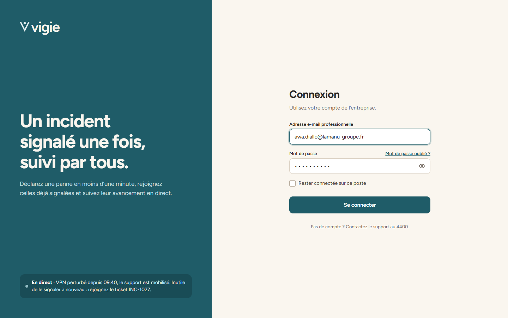
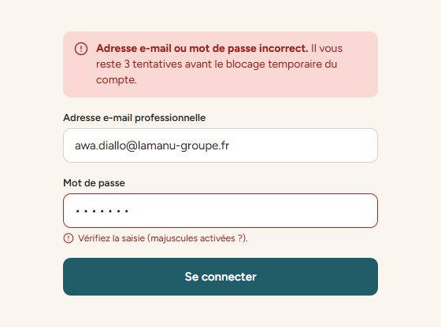
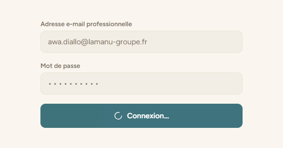
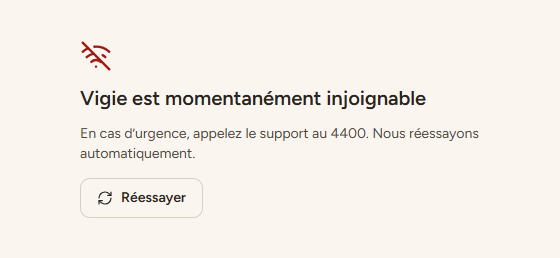

# 01 — Connexion

Route : `/connexion` · Rôles : tous · Stories : VIGIE-2 (fonctionnement), VIGIE-49 (mise en forme selon cette fiche)

| Normal                                 | Erreur                                | Chargement                                | Indisponible                                |
| -------------------------------------- | ------------------------------------- | ----------------------------------------- | ------------------------------------------- |
|  |  |  |  |

## Mise en page (1440 × 900, pas de barre latérale)

Grille 2 colonnes : `600px minmax(0, 1fr)`.

- **Panneau gauche** 600 px, fond `--color-brand-600`, texte `--color-neutral-50`, marges 56 px, colonne
  `justify-content: space-between` (logo en haut, promesse au milieu, encart en bas) :
  - logo « vigie » 40 px / 600, approche -0.035em (symbole 0,7 em) ;
  - promesse 52/58, 700, approche -0.03em, `text-wrap: balance`, puis 20 px plus bas l'accroche 17/26,
    `--color-brand-200`, largeur max. 440 px ;
  - encart « En direct » : fond `--color-brand-700`, rayon 14, marges 14 × 16, écart 10, texte 14/20
    `--color-brand-100` ; point de 8 px `--color-brand-300` ; « En direct » en blanc.
- **Colonne droite** : formulaire de 400 px centré verticalement et horizontalement, colonne, écart 28 :
  - titre « Connexion » 30/38/700 (`.text-display-lg`) et sous-titre 15/22 Taupe, écart 8 ;
  - champs, écart 18 ; libellé 13/600, écart 6. **Champs de 44 px** ici (marges 0 14, texte 15 px) au lieu
    de 40 ; mot de passe avec bouton `eye` 18 px Taupe ;
  - case « Rester connecté(e) » 14 px `--color-neutral-700`, case 18 px rayon 4 — voir ⚠ ;
  - bouton principal **pleine largeur, 48 px**, 15/600 ;

## Textes exacts

- Promesse : « Un incident signalé une fois, suivi par tous. »
- Accroche : « Déclarez une panne en moins d’une minute, rejoignez celles déjà signalées et suivez leur avancement en direct. »
- Encart : « **En direct** · VPN perturbé depuis 09:40, le support est mobilisé. Inutile de le signaler à nouveau : rejoignez le ticket INC-1027. » (service, heure et ticket = données)
- Titre « Connexion » · sous-titre « Utilisez votre compte de l’entreprise. »
- Champs : « Adresse e-mail professionnelle » · « Mot de passe » (bouton `eye` pour afficher le mot de passe)
- Bouton : « Se connecter » → en chargement « Connexion… »
- Erreur (bandeau danger) : « **Adresse e-mail ou mot de passe incorrect.** » ; sous le champ : « Vérifiez la saisie (majuscules activées ?). »
- Indisponible : « Vigie est momentanément injoignable » · « En cas d’urgence, appelez le support au 4400. Nous réessayons automatiquement. » · bouton « Réessayer » (`refresh-cw`) · icône `wifi-off` 32 px.

## États

| État         | Rendu                                                                                                                                                             |
| ------------ | ----------------------------------------------------------------------------------------------------------------------------------------------------------------- |
| Normal       | Ci-dessus. Champ actif : bordure `--color-brand-600` + `--shadow-field-focus`.                                                                                    |
| Erreur       | Bandeau `--color-feedback-danger-bg` / `-fg`, rayon 10, marges 12 × 14, icône `circle-alert` 18 ; champ mot de passe en erreur (bordure `--color-danger-button`). |
| Chargement   | Champs désactivés (fond `--color-neutral-100`), bouton « Connexion… » avec `loader-circle` tournant.                                                              |
| Indisponible | API injoignable : icône, titre 20/600, texte 14/20, bouton Secondaire « Réessayer ».                                                                              |
| Temps réel   | L'encart « En direct » affiche l'état des services (si la fonctionnalité existe, sinon il est masqué).                                                            |

## ⚠ Écarts avec les règles

- « Mot de passe oublié ? », « Rester connectée sur ce poste » et « Il vous reste 3 tentatives avant le blocage
  temporaire du compte » ne correspondent à aucune règle ni story : **ne pas les afficher** sans story.
- L'encart « En direct » dépend de l'État des services, intégré à **VIGIE-42** (cadrage 9.8) : masqué tant que cette story n'est pas livrée.
- **Choix de VIGIE-49** (20/11) : l’API est vérifiée à l’ouverture (`/api/health`) et en cas d’erreur réseau ou
  serveur ; dans l’état « injoignable », nouvel essai automatique toutes les 10 s. Champ vide : message sous le
  champ (« Indiquez votre adresse e-mail. », « Indiquez votre mot de passe. », textes ajoutés, absents de la
  maquette). Sous 768 px, le panneau devient un bandeau (logo et promesse, sans l’accroche).
- **Pas de pied « Pas de compte ? Contactez le support au 4400. »** (décision du 20/11).
