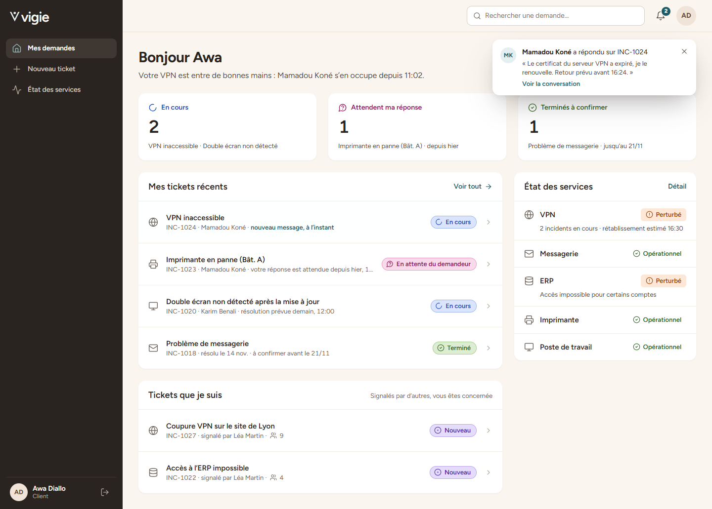
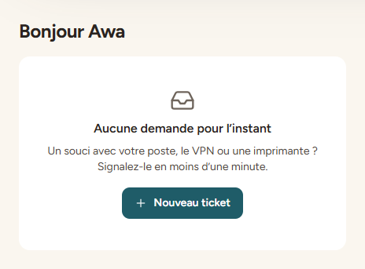
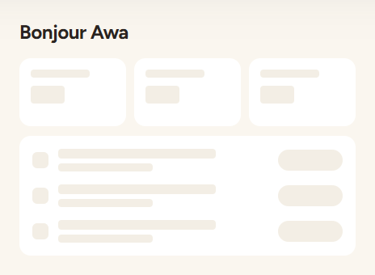
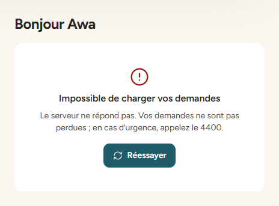

# 02 — Mes demandes (accueil Client)

Route : `/mes-demandes` · Rôle : Client · Story : VIGIE-18

| Normal (temps réel)                       | Vide                                   | Chargement                                   | Erreur                                   |
| ----------------------------------------- | -------------------------------------- | -------------------------------------------- | ---------------------------------------- |
|  |  |  |  |

Version mobile : [14-mobile.md](14-mobile.md).

## Mise en page

Gabarit connecté ([README](README.md)) ; en-tête avec recherche « Rechercher une demande… », cloche, avatar.
Contenu, colonne, écart 24 :

1. **Accueil** (rangée `space-between`, alignée en bas, écart 24) : à gauche « Bonjour Awa »
   (`.text-display-lg`) et la phrase d'état 16/24 `--color-neutral-700` (écart 6) ; à droite le bouton
   Primaire « Nouveau ticket » **44 px**, marges 0 18, 15/600, icône `plus` 18.
2. **3 cartes de synthèse** : grille `repeat(3, minmax(0, 1fr))`, écart 24. Carte blanche, rayon 14,
   marges 20, écart 10, `--shadow-xs` : en-tête icône 18 + libellé 14/600 **dans la couleur `-fg` du
   statut** (`loader-circle` En cours, `message-circle-question` En attente, `circle-check` Terminé),
   chiffre `.text-numeric-xl`, détail 13/18 `--color-neutral-700` tronqué.
3. **Deux colonnes** : grille `minmax(0, 8fr) minmax(0, 4fr)`, écart 24, alignées en haut.
   - Gauche, colonne écart 24 : carte « Mes tickets récents » puis carte « Tickets que je suis ».
     Carte : blanche, rayon 14, `--shadow-xs` ; en-tête marges 18 × 20, titre 18/600, à droite le lien
     « Voir tout » 14/600 Pétrole + `arrow-right` 16 (ou le sous-titre 13 Taupe).
     **Ligne** : grille `20px minmax(0, 1fr) auto 16px`, écart 16, hauteur min. 64, marges 10 × 20, filet
     haut `--color-neutral-100` ; icône du service 20 Taupe ; titre 15/600 et méta 13 Taupe tronqués
     (écart 3), la partie « nouveau message, à l’instant » en Pétrole 600 ; **StatusBadge 26** ;
     `chevron-right` 16 `--color-neutral-400`. Toute la ligne est cliquable.
   - Droite : carte « État des services » (lien « Détail »). Ligne : marges 14 × 20, filet haut, icône du
     service 20 Taupe, nom 15/600, badge d'état à droite (hauteur 26, marges 0 10, rayon 6, 13/600,
     icône 15 : Opérationnel = `circle-check` `--color-sla-ok-fg` sans fond ; Perturbé = `circle-alert`
     `--color-sla-proche-fg` sur `--color-sla-proche-bg`), puis pour un service perturbé une note 13 Taupe.

## Textes exacts

- Phrase d'état (exemple) : « Votre VPN est entre de bonnes mains : Mamadou Koné s’en occupe depuis 11:02. »
- Cartes : « En cours » · « Attendent ma réponse » · « Terminés à confirmer » ; détail = titres des tickets
  séparés par « · », puis « depuis hier » ou « jusqu’au JJ/MM ».
- « Mes tickets récents » · « Voir tout » · « Tickets que je suis » · « Signalés par d’autres, vous êtes concernée »
- Méta d'une ligne : « INC-1024 · Mamadou Koné · nouveau message, à l’instant » ;
  « … · votre réponse est attendue depuis hier, 17:15 » ; « … · résolution prévue demain, 12:00 » ;
  « INC-1018 · résolu le 14 nov. · à confirmer avant le JJ/MM » ; suivi : « INC-1027 · signalé par Léa Martin · » + `users` + nombre.
- « État des services » · « Détail » · « Opérationnel » · « Perturbé » · note : « 2 incidents en cours · rétablissement estimé 16:30 »
- Toast temps réel : « **Mamadou Koné** a répondu sur INC-1024 » · citation entre « » · lien « Voir la conversation ».
- Vide : « Aucune demande pour l’instant » · « Un souci avec votre poste, le VPN ou une imprimante ? Signalez-le en moins d’une minute. » · bouton Primaire « Nouveau ticket ».
- Erreur : « Impossible de charger vos demandes » · « Le serveur ne répond pas. Vos demandes ne sont pas perdues ; en cas d’urgence, appelez le 4400. » · « Réessayer ».

## États

| État       | Rendu                                                                                                       |
| ---------- | ----------------------------------------------------------------------------------------------------------- |
| Vide       | Titre conservé ; carte EmptyState (`inbox` 32, marges 40 × 24) avec le bouton Primaire.                     |
| Chargement | Titre conservé ; 3 cartes squelettes puis carte de 3 lignes squelettes (pastille 80 × 26 pour le statut).   |
| Erreur     | Carte ErrorState (`circle-alert` `--color-feedback-danger-fg`) avec bouton Primaire « Réessayer ».          |
| Temps réel | Ligne mise à jour surlignée (`vigie-surbrillance`, 1,5 s) + toast en haut à droite (400 px, `--shadow-lg`). |

## ⚠ Écarts avec les règles

- « jusqu’au 21/11 » et « à confirmer avant le 21/11 » : la contestation dure **15 jours** (cadrage 3.1) →
  date affichée = passage en Terminé + 15 jours (exemple : 29/11).
- Carte « État des services » : fonctionnalité sans story (cadrage 9.9) ; la colonne de droite reste vide ou
  est retirée tant qu'elle n'existe pas.
