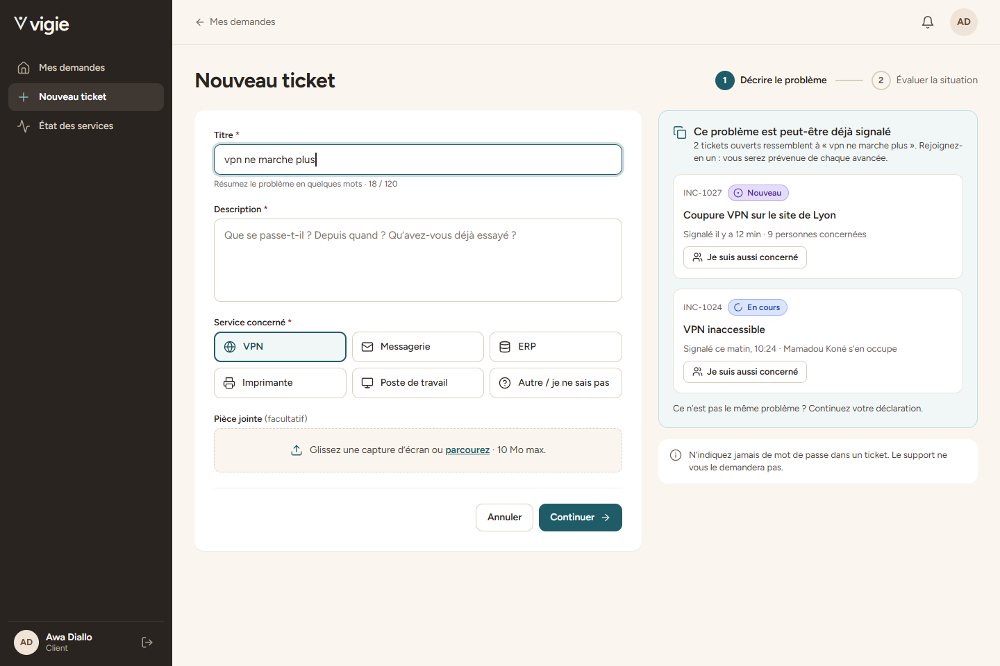
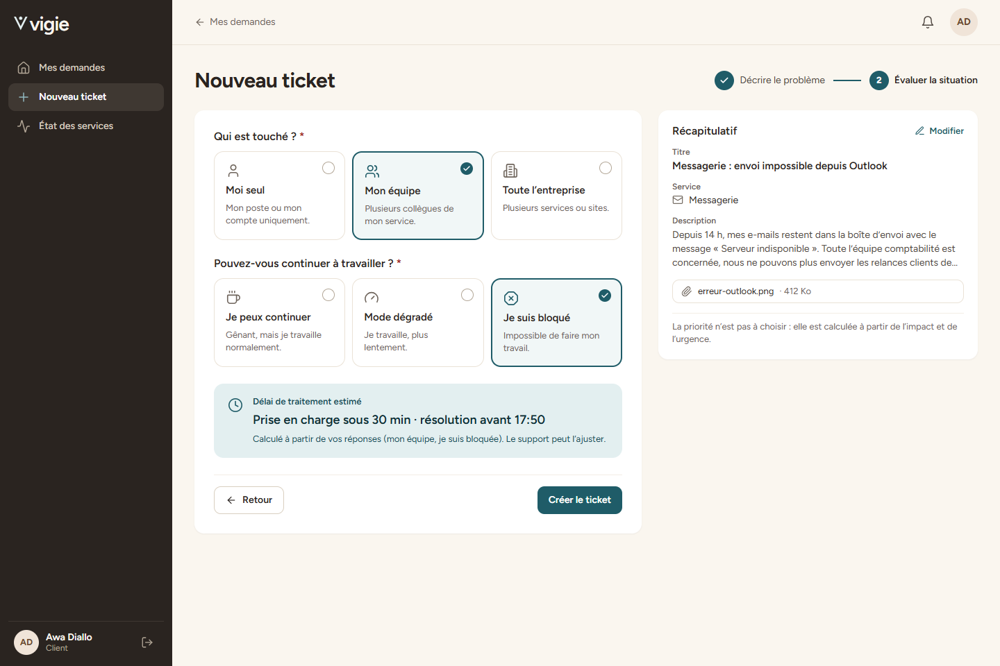
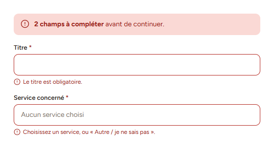
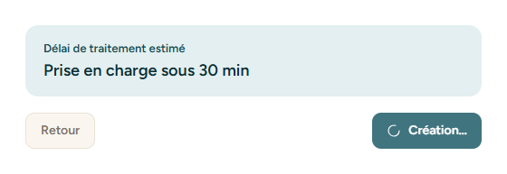
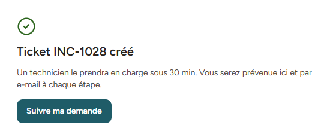

# 03 — Créer un ticket

Route proposée : `/tickets/nouveau` · Rôle : Client (le Gestionnaire passe par [04](04-creer-pour-un-tiers.md))

| Étape 1 · doublon détecté                    | Étape 2 · délai estimé                       |
| -------------------------------------------- | -------------------------------------------- |
|  |  |

| Erreurs de validation                       | Envoi en cours                             | Confirmation                                      |
| ------------------------------------------- | ------------------------------------------ | ------------------------------------------------- |
|  |  |  |

Parcours cliquable : [parcours.md](parcours.md) (parcours 1). Mobile : [14-mobile.md](14-mobile.md).

## Mise en page

En-tête : lien retour « ← Mes demandes » (14 Taupe, `arrow-left` 16), puis cloche et avatar (pas de recherche).
Contenu, colonne, écart 24 :

1. **Titre et étapes** (rangée `space-between`) : « Nouveau ticket » (`.text-display-lg`) ; à droite
   l'indicateur d'étapes 14 px, écart 12 : rond 28 numéroté (13/700) + libellé, reliés par un trait
   40 × 2. Étape courante : rond plein `--color-brand-600`, libellé 600. Étape à venir : rond bordé
   2 px `--color-neutral-300`, libellé Taupe. Étape faite : rond plein avec coche (trait 3), trait
   `--color-brand-600`, libellé `--color-neutral-700`.
2. **Deux colonnes** : grille `minmax(0, 7fr) minmax(0, 5fr)`, écart 24, alignées en haut.
   - **Formulaire** : carte blanche, rayon 14, marges 28, `--shadow-xs`, colonne écart 22 (étape 2 : 24).
   - **Colonne droite** (étape 1) : panneau de doublons puis encart d'information ; (étape 2) carte
     « Récapitulatif ».

### Étape 1 — Décrire le problème

- **Champs de 44 px** (marges 0 14, texte 15), libellé 13/600 au-dessus, astérisque
  `--color-feedback-danger-fg`, aide 12 Taupe en dessous.
- Titre : aide « Résumez le problème en quelques mots · 18 / 120 » (compteur sur 120 caractères).
- Description : zone de texte hauteur min. 120, marges 12 × 14, 15/22.
- **Service concerné** : grille de 6 cartes `repeat(3, minmax(0, 1fr))`, écart 8 ; carte 44 px, marges
  0 12, rayon 10, écart 10, icône 18, 14 px. Choisie : bordure 2 px `--color-brand-600`, fond
  `--color-brand-50`, texte `--color-brand-700` 600. Sinon : bordure 1 px `--color-neutral-300`, 500.
  Ordre : VPN, Messagerie, ERP, Imprimante, Poste de travail, Autre / je ne sais pas (toujours en dernier).
- Pièces jointes : zone de dépôt 64 px, bordure `1.5px dashed --color-neutral-300`, fond Lin, icône
  `upload` 18 Pétrole, « parcourez » souligné Pétrole 600.
- Pied : filet haut `--color-neutral-100`, boutons à droite, écart 8 : Secondaire « Annuler », Primaire
  « Continuer » + `arrow-right`.
- **Panneau « Ce problème est peut-être déjà signalé »** (DuplicatePanel) : bordure `--color-brand-200`,
  fond `--color-brand-50`, rayon 14, marges 20, écart 14 ; icône `copy` 20 Pétrole ; titre 16/600 ;
  texte 13/18 `--color-neutral-700`. Carte de ticket : blanche, bordure Sable, rayon 12, marges 14,
  écart 10 ; numéro 12 Taupe + StatusBadge 24 ; titre 15/20/600 ; méta 13 Taupe ; bouton Secondaire sm
  « Je suis aussi concerné » (`users`). Sous les cartes : « Ce n’est pas le même problème ? Continuez
  votre déclaration. » 13 `--color-neutral-700`. Apparaît dès **3 caractères**, **300 ms** après la
  dernière frappe, **1 à 3 tickets**.
- Encart sous le panneau : blanc, rayon 14, marges 14 × 16, écart 10, icône `info` 18 Taupe, 13/18.

### Étape 2 — Évaluer la situation

- Deux groupes de 3 **cartes de choix** (ChoiceCard, `role="radio"`) : question 16/600 + astérisque,
  grille `repeat(3, minmax(0, 1fr))`, écart 10. Carte : hauteur min. 116, marges 16, rayon 14, écart 8 ;
  icône 22 ; titre 15/600 ; description 13/18 Taupe ; rond 18 en haut à droite (14, 14).
  Choisie : bordure 2 px `--color-brand-600`, fond `--color-brand-50`, icône Pétrole, rond plein avec coche
  blanche. Sinon : bordure 1 px Sable, icône Taupe, rond bordé `1.5px --color-neutral-400`.
- **Délai de traitement estimé** (DelayEstimate) : fond `--color-brand-100`, rayon 14, marges 18 × 20,
  écart 14, icône `clock` 22 Pétrole ; libellé 13/600 `--color-brand-700` ; valeur 18/26/600
  `--color-brand-900` ; explication 13/18 `--color-brand-700`.
- Pied : filet haut, `space-between` : Secondaire « Retour » (`arrow-left`), Primaire « Créer le ticket ».
- **Récapitulatif** : carte blanche, marges 20, écart 14 ; titre 16/600 + lien « Modifier » (`pen-line` 15,
  13/600 Pétrole) ; rubriques libellé 12/600 Taupe + valeur (titre 15/600 ; service avec icône 16 ;
  description 14/20 `--color-neutral-700` sur 3 lignes max.) ; pièce jointe en ligne bordée Sable, rayon 10 ;
  note finale 13/18 Taupe sous un filet.

## Textes exacts

- Étapes : « Décrire le problème » · « Évaluer la situation »
- Champs : « Titre * » · « Description * » (placeholder « Que se passe-t-il ? Depuis quand ? Qu’avez-vous déjà essayé ? ») · « Service concerné * » · « Pièces jointes (facultatif) »
- Panneau : « Ce problème est peut-être déjà signalé » · « 2 tickets ouverts ressemblent à « vpn ne marche plus ». Rejoignez-en un : chaque avancée vous sera signalée. » · « Je suis aussi concerné » · « Ce n’est pas le même problème ? Continuez votre déclaration. »
- Encart : « N’indiquez jamais de mot de passe dans un ticket. Le support ne vous le demandera pas. »
- Questions : « Qui est touché ? » (Moi seul / Mon équipe / Toute l’entreprise) · « Pouvez-vous continuer à travailler ? » (Je peux continuer / Mode dégradé / Je suis bloqué) ; descriptions dans `libelles.js` et [composants.md](composants.md).
- Délai : « Délai de traitement estimé » · valeur = **échéance SLA** : « Résolution prévue avant le 20/11 à 11 h » · explication « Calculé à partir de vos réponses : priorité Haute. Le support peut l’ajuster. »
- Récapitulatif : « Récapitulatif » · « Modifier » · « Titre » · « Service » · « Description » · note « La priorité n’est pas à choisir : elle est calculée à partir de l’impact et de l’urgence. »
- Boutons : « Annuler » · « Continuer » · « Retour » · « Créer le ticket » → « Création… »
- Erreurs : bandeau « **2 champs à compléter** avant de continuer. » ; « Le titre est obligatoire. » ; « Choisissez un service, ou « Autre / je ne sais pas ». » ; placeholder du service vide « Aucun service choisi ».
- Confirmation : icône `circle-check` 32 `--color-feedback-success-fg` · « Ticket INC-1028 créé » (20/600) · « Résolution prévue avant le 20/11 à 11 h. Chaque étape vous sera notifiée ici et par e-mail. » · Primaire « Suivre ma demande ».

## États

| État       | Rendu                                                                                                                                                              |
| ---------- | ------------------------------------------------------------------------------------------------------------------------------------------------------------------ |
| Normal     | Étapes 1 et 2 ci-dessus. Délai « en attente » tant que les deux questions n'ont pas de réponse ([composants.md](composants.md)).                                   |
| Erreur     | Bandeau danger (marges 12 × 14, rayon 10, `circle-alert` 18) + champs en erreur (bordure `1.5px --color-danger-button`) + message 12 `--color-feedback-danger-fg`. |
| Chargement | Envoi : « Retour » désactivé, Primaire « Création… » avec `loader-circle`. Panneau de doublons : « Recherche de tickets similaires… » + squelettes.                |
| Vide       | Aucun doublon : encart « Aucun ticket ouvert ne ressemble au vôtre. Continuez. » (`info`).                                                                         |
| Temps réel | Le panneau de doublons réagit pendant la saisie (appel REST, pas Socket.io).                                                                                       |

## ⚠ Écarts avec les règles

- **Description guidée** (cadrage 9.9, VIGIE-3) : **trois questions** (« Que se passe-t-il ? », « Depuis quand ? »,
  « Quel message d’erreur ? ») au lieu du champ unique de la maquette. Même style de champ que la Description
  (zone de texte, libellé au-dessus) ; libellés exacts à reprendre de la story VIGIE-3.
- **Données personnelles** (cadrage 9.9) : l’encart « N’indiquez jamais de mot de passe… » doit aussi rappeler de ne
  pas mettre de données personnelles dans le titre et la description ; texte à valider avec l’équipe.
- **Pièces jointes** : « 10 Mo max. » → « Glissez un fichier ou parcourez · 5 Mo max. par fichier, 5 fichiers »
  (cadrage 9.4 : png, jpg, pdf, txt, log, csv, docx, xlsx).
- **Suggestions de doublons** (cadrage 9.3, plan A : titre, service, statut, date d'ouverture uniquement) :
  méta « Signalé il y a 12 min · VPN » au lieu de « 9 personnes concernées » ou « Mamadou Koné s’en occupe ».
- **Délai estimé** (décision 9.11) : pas de « Prise en charge sous 30 min » ; on affiche l'**échéance SLA**
  (cadrage 9.2) : « Résolution prévue avant le 20/11 à 11 h ». Vaut aussi pour l'envoi, la confirmation et le
  toast de succès (« INC-1028 · résolution prévue avant le 20/11 à 11 h »).
- **Formulations neutres** (décision 9.11) : pas d'accord au féminin (« prévenue », « bloquée ») ; textes
  reformulés sans accord, comme ci-dessus.
