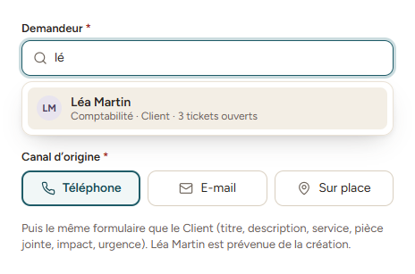

# 04 — Créer un ticket pour un tiers

Route proposée : `/tickets/nouveau` (même page que [03](03-creer-un-ticket.md), version Gestionnaire) ·
Rôles : Gestionnaire, Administrateur

## Mise en page

Le formulaire de [03 — Créer un ticket](03-creer-un-ticket.md) (titre, description, service, pièces jointes,
impact, urgence), précédé de deux champs propres au Gestionnaire, colonne écart 16 :

1. **Demandeur *** : champ de recherche 40 px (`search` 16 Taupe), recherche dans l'annuaire pendant la
   frappe. Liste de résultats sous le champ : bordure Sable, rayon 12, marges 6, écart 2, `--shadow-md`.
   Résultat : marges 8 × 10, rayon 8, écart 10 ; Avatar 28 (initiales 11/700) ; nom 14/600 ; détail
   12 Taupe (« Comptabilité · Client · 3 tickets ouverts »). Résultat survolé : fond `--color-neutral-100`.
   Recherche en cours : `loader-circle` tournant à droite du champ et aide « Recherche dans l’annuaire… ».
2. **Canal d’origine *** : 3 cartes `repeat(3, 1fr)`, écart 8 ; carte 40 px, rayon 10, centrée, écart 8,
   icône 16 (`phone`, `mail`, `map-pin`). Choisie : bordure 2 px `--color-brand-600`, fond
   `--color-brand-50`, texte `--color-brand-700` 600. Sinon : bordure 1 px `--color-neutral-300`, icône Taupe.

## Textes exacts

- « Demandeur * » · aide « Gestionnaire : ticket créé pour un tiers. »
- « Canal d’origine * » : « Téléphone » · « E-mail » · « Sur place » (`TELEPHONE`, `EMAIL`, `DIRECT`)
- Le demandeur est prévenu de la création (notification et e-mail).

## Règles

- Le tiers devient le demandeur ; le gestionnaire reste tracé comme créateur (cadrage 3.1).
- Un ticket créé par le demandeur lui-même a le canal `APPLICATION`, affiché « Vigie ».

## États

Comme [03](03-creer-un-ticket.md). Erreur propre : aucun demandeur choisi → message sous le champ
(même style que « Le titre est obligatoire. »).
