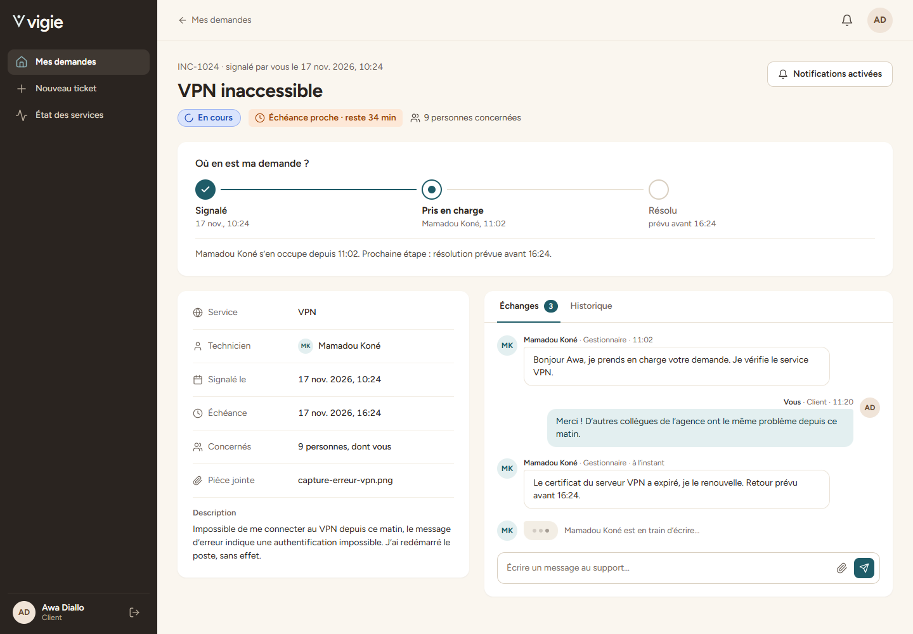
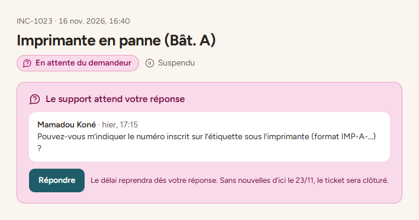
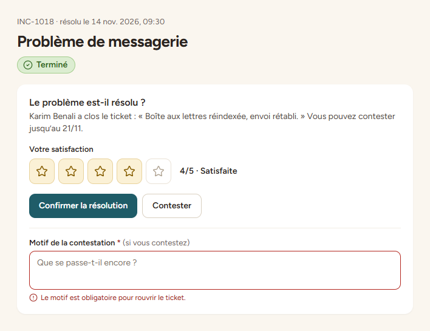
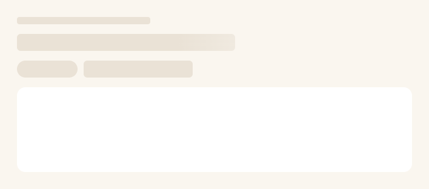
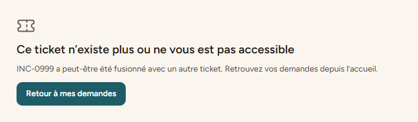

# 05 — Fiche ticket (vue Client)

Route proposée : `/tickets/:id` · Rôle : Client (demandeur ou suiveur)

| En attente du demandeur                             | Terminé · confirmer ou contester                 |
| --------------------------------------------------- | ------------------------------------------------ |
|  |  |

| Chargement                                          | Erreur (ticket introuvable)                     |
| --------------------------------------------------- | ----------------------------------------------- |
|  |  |

Parcours cliquables : [parcours.md](parcours.md) (2 et 3). Mobile : [14-mobile.md](14-mobile.md).

## Mise en page

En-tête : lien retour « ← Mes demandes », cloche, avatar. Contenu, colonne, écart 24 :

1. **En-tête du ticket** (rangée `space-between`, alignée en haut, écart 24) :
   - colonne écart 10 : méta 14 Taupe tabulaire ; titre `.text-display-lg` ; rangée écart 12 (retour à la
     ligne possible) : **StatusBadge 28**, **SlaBadge 28**, nombre de concernés (`users` 16, 14
     `--color-neutral-700`) ;
   - à droite : bouton Secondaire « Notifications activées » (`bell`) — voir ⚠.
2. **« Où en est ma demande ? »** (ProgressTracker) : carte blanche, rayon 14, marges 24 × 28, écart 16,
   `--shadow-xs` ; titre 16/600 ; **4 jalons** en grille `repeat(4, minmax(0, 1fr))` : rond **32**, bordure 2,
   icône 16, trait 2 px (marges 0 8) ; libellé 15 ; date 13 Taupe ; message 14/20 `--color-neutral-700` sous
   un filet `--color-neutral-100` (marge haute 14).
3. **Deux colonnes** : grille `minmax(0, 5fr) minmax(0, 7fr)`, écart 24, alignées en haut.
   - **Informations** : carte blanche, marges 8 × 24. Ligne : grille `150px minmax(0, 1fr)`, écart 16,
     hauteur min. 52, filet bas `--color-neutral-100`, 14 px ; libellé Taupe avec icône 16 ; valeur 500
     (technicien avec Avatar 24). Puis bloc « Description » (libellé 13/600 Taupe, texte 14/21).
   - **Échanges / Historique** : carte blanche. Onglets (hauteur 48, marges 0 20, filet bas Sable) :
     actif souligné 2 px Pétrole 600 avec compteur ; inactif 500 Taupe. Fil de messages, marges 20, écart 18 :
     CommentBubble (avatar 32, largeur max. 80 %), TypingIndicator, puis le champ de réponse (hauteur min. 48,
     bordure `--color-neutral-300`, rayon 12, `paperclip` 18, bouton d'envoi 32 Pétrole).

### Variante « En attente du demandeur »

Sous l'en-tête : bandeau fond `--color-status-en-attente-bg`, bordure `--color-status-en-attente-border`,
rayon 14, marges 18 × 20, écart 12 ; titre 16/600 `--color-status-en-attente-strong` avec
`message-circle-question` 20 ; la question du technicien dans une bulle blanche (rayon 12, marges 12 × 14,
14/20 ; nom 600 · date Taupe) ; rangée : Primaire « Répondre » + note 13 `--color-status-en-attente-strong`.
L'en-tête affiche SlaBadge « Suspendu » (forme `circle-pause`, sans fond). La frise reste sur « Pris en charge »,
avec la mention « En attente de votre réponse ».

### Variante « Abandonné »

Pas de frise : un message avec le motif d'abandon (par exemple « Abandonné : rattaché à INC-1015 (doublon). Vous
suivez désormais ce ticket. »).

### Variante « Terminé »

Carte blanche, marges 20, écart 16 :

- « Le problème est-il résolu ? » 16/600 + message de clôture 14/20 `--color-neutral-700` ;
- « Votre satisfaction » 13/600 : 5 étoiles en boutons 40 × 40, rayon 10, icône `star` 20 ; étoile pleine
  `--color-rating-fg` sur `--color-rating-bg`, bordure `--color-rating-border` ; vide `--color-neutral-400`
  sur blanc, bordure Sable ; puis « 4/5 » 14/600 ;
- Primaire « Confirmer la résolution » + Secondaire « Contester » ;
- sous un filet : « Motif de la contestation * (si vous contestez) », zone de texte 64 px.

## Textes exacts

- Méta : « INC-1024 · signalé par vous le 17 nov. 2026, 10:24 »
- « 9 personnes concernées » · « Notifications activées » · « Où en est ma demande ? »
- Jalons : « Reçu » · « Vu par le support » · « Pris en charge » · « Terminé » (les captures montrent les 3 étapes de la maquette) ; message : « Mamadou Koné s’en occupe depuis 11:02. Prochaine étape : résolution prévue avant 16:24. »
- Informations : « Service » (`globe` selon le service) · « Technicien » (`user`) · « Signalé le » (`calendar`) · « Échéance » (`clock`) · « Concernés » (`users`, « 9 personnes, dont vous ») · « Pièce jointe » (`paperclip`) · « Description »
- Onglets : « Échanges » · « Historique » ; en-tête de bulle : « Mamadou Koné · Gestionnaire · 11:02 », « Vous · Client · 11:20 »
- « Mamadou Koné est en train d’écrire… » · champ : « Écrire un message au support… »
- En attente : « Le support attend votre réponse » · « Répondre » · « Le délai reprendra dès votre réponse. »
- Terminé : « Le problème est-il résolu ? » · « Karim Benali a clos le ticket : « … » (la **solution** saisie à la clôture, cadrage 9.9). Vous pouvez contester jusqu’au JJ/MM. » · « Votre satisfaction » · « Confirmer la résolution » · « Contester » · « Motif de la contestation * (si vous contestez) » · placeholder « Que se passe-t-il encore ? » · erreur « Le motif est obligatoire pour rouvrir le ticket. »
- Erreur : icône `ticket` 32 Taupe · « Ce ticket n’existe plus ou ne vous est pas accessible » (20/600) · « INC-0999 a peut-être été fusionné avec un autre ticket. Retrouvez vos demandes depuis l’accueil. » · Primaire « Retour à mes demandes ».

## États

| État       | Rendu                                                                                                                                                                    |
| ---------- | ------------------------------------------------------------------------------------------------------------------------------------------------------------------------ |
| Chargement | Squelettes sur fond Lin : méta 220 × 12, titre 360 × 28 (reflet), badges 100 × 28 et 180 × 28, carte 140 px. Teinte `--color-neutral-200`, reflet `--color-neutral-100`. |
| Erreur     | Introuvable ou non autorisé : même message (ne pas révéler l'existence du ticket).                                                                                       |
| Vide       | Aucun échange : le fil n'affiche que le champ de réponse.                                                                                                                |
| Temps réel | Message reçu, « en train d’écrire… », statut et suivi mis à jour, toast (voir [parcours 2](parcours.md)).                                                                |

## ⚠ Écarts avec les règles

- « Sans nouvelles d’ici le 23/11, le ticket sera clôturé. » → **aucune clôture automatique** (cadrage 3.1) :
  « Sans réponse de votre part, nous vous relancerons le JJ/MM. » (relance après 3 jours).
- « Vous pouvez contester jusqu’au 21/11 » → **15 jours** après le passage en Terminé (cadrage 3.1).
- Suivi (décision 9.11) : **4 jalons** « Reçu → Vu par le support → Pris en charge → Terminé », et non les
  3 étapes de la maquette ; codé avec la fiche ticket (**VIGIE-7**), champ `vuParSupportLe`.
- « 4/5 · Satisfaite » → « 4/5 » : formulation neutre, sans accord (décision 9.11).
- « Notifications activées » (suivre ou non le ticket) : sans story.
- Notes internes : jamais affichées ici (filtrées par l'API, jamais émises vers un Client).
