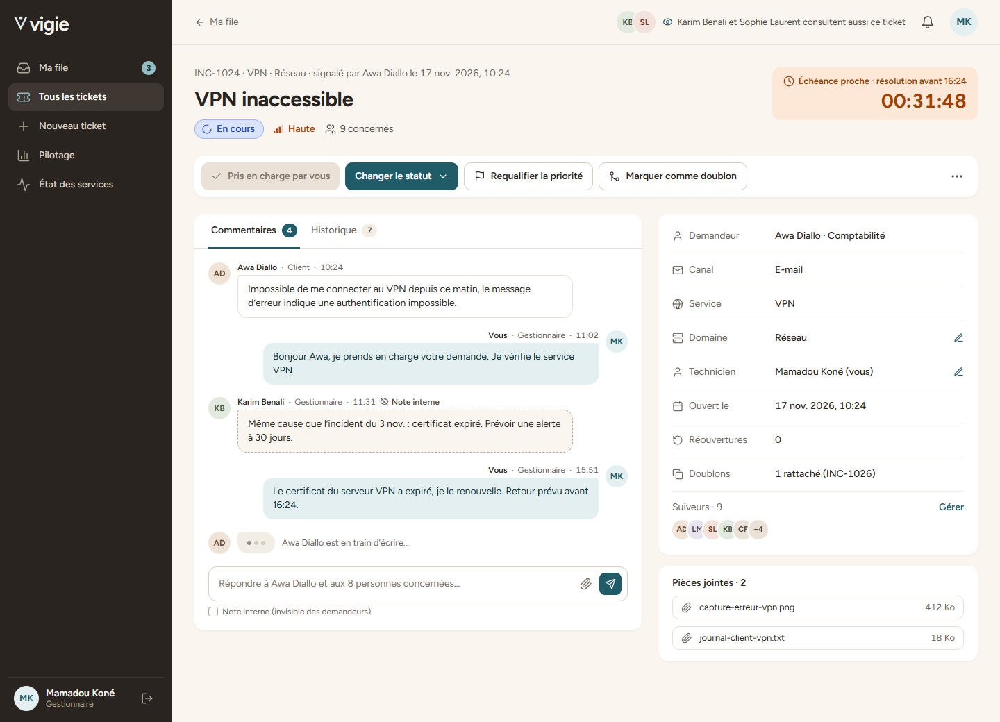
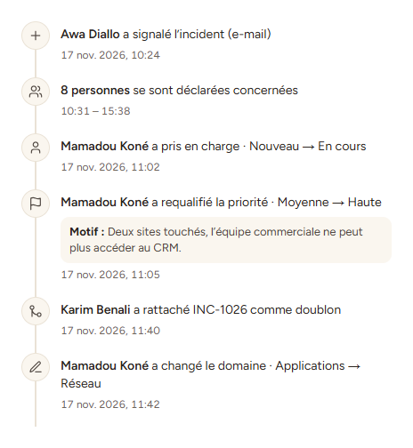
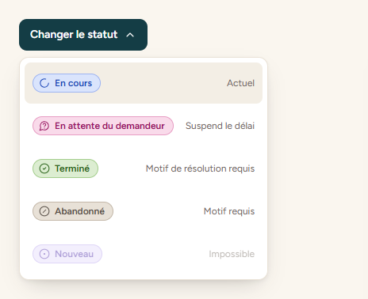
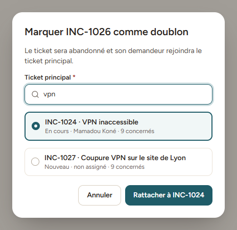

# 06 — Fiche ticket (vue Gestionnaire)

Route proposée : `/tickets/:id` · Rôles : Gestionnaire, Administrateur ; Lecteur en lecture seule
(sans barre d'actions ni champ de réponse)

| Historique                                                | Menu « Changer le statut »             | Fenêtre « Marquer comme doublon »          |
| --------------------------------------------------------- | -------------------------------------- | ------------------------------------------ |
|  |  |  |

## Mise en page

**En-tête** : lien retour « ← Ma file » ; **présence** (PresenceAvatars) : avatars 32 superposés (−8 px,
anneau 2 px Lin) + `eye` 15 Pétrole + texte 13 `--color-neutral-700`, écart 10 ; puis cloche et avatar.
Pas de recherche.

Contenu, colonne, écart 24 :

1. **En-tête du ticket** (rangée `space-between`, alignée en haut) :
   - colonne écart 10 : méta 14 Taupe ; titre `.text-display-lg` ; rangée écart 14 : **StatusBadge 28**,
     **priorité** (barres + libellé 14/600, sans fond), concernés (`users` 16, 14 `--color-neutral-700`) ;
   - à droite, **compte à rebours SLA** : bloc colonne alignée à droite, marges 12 × 16, rayon 12, fond et
     texte du niveau SLA (ici `--color-sla-proche-bg` / `-fg`) ; ligne `clock` 16 + texte 13/600 ; décompte
     **28/32/700 tabulaire** « 00:31:48 ».
2. **Barre d'actions** : carte blanche, marges 10, rayon 14, écart 8, `--shadow-xs`. Boutons 40 px, marges
   0 14, écart 8, icône 16 :
   - « Prendre en charge » (Primaire) ; une fois pris : « Pris en charge par vous » (`check`, style désactivé
     `--color-neutral-200` / `--color-neutral-500`) ;
   - « Changer le statut » (Primaire + `chevron-down`) ; ouvert : fond `--color-brand-800`, chevron retourné ;
   - « Requalifier la priorité » (Secondaire, `flag`) ; « Marquer comme doublon » (Secondaire, `git-merge`) ;
   - à droite, IconButton `ellipsis` (« Plus d’actions »).
3. **Deux colonnes** : grille `minmax(0, 7fr) minmax(0, 5fr)`, écart 24, alignées en haut.
   - **Commentaires / Historique** : carte blanche ; onglets 48 px avec compteurs (actif Pétrole, inactif
     `--color-neutral-100` / `--color-neutral-700`) ; fil marges 20, écart 18 ; bulles (CommentBubble) :
     reçue blanche bordée Sable, envoyée `--color-brand-100` alignée à droite (« Vous »), **note interne**
     fond Lin + bordure `1px dashed --color-neutral-400` + étiquette `eye-off` 13 « Note interne » 600
     `--color-neutral-700` ; TypingIndicator ; champ de réponse (hauteur min. 48, rayon 12) puis case
     « Note interne (invisible des demandeurs) » 12 Taupe (case 14 px, rayon 4).
   - **Panneau de droite**, colonne écart 16 :
     - carte Informations, marges 8 × 20 ; ligne grille `136px minmax(0, 1fr)`, écart 12, hauteur min. 48,
       filet bas, 14 px ; libellé Taupe + icône 16 ; valeur 500 tabulaire ; `pen-line` 15 Pétrole à droite
       pour les champs modifiables (Domaine) ;
     - Suiveurs : « Suiveurs · 9 » 14 Taupe + lien « Gérer » 600 Pétrole ; avatars 28 (11/700, anneau 2 px
       blanc, −6 px) ;
     - carte « Pièces jointes · 2 » (marges 16 × 20, écart 10) : ligne bordée Sable, rayon 10, marges
       8 × 12, `paperclip` 16, nom tronqué, taille Taupe.

### Historique (TimelineItem)

Grille `32px minmax(0, 1fr)`, écart 12 ; rond 32 fond Lin + bordure Sable, icône 16 `--color-neutral-700` ;
trait 1,5 px Sable ; texte 14/20 avec le nom en 600 ; motif en encart fond Lin, rayon 10, marges 8 × 10,
13/18, « Motif : » en Encre ; date 12 Taupe tabulaire. Icônes : `plus` signalé, `users` concernés, `user`
pris en charge, `flag` priorité, `git-merge` doublon, `pen-line` domaine, `rotate-ccw` réouverture.

### Menu « Changer le statut »

Menu 300 px, bordure Sable, rayon 12, marges 6, écart 2, `--shadow-md`. Option : hauteur min. 40, marges
6 × 10, rayon 8, écart 10 ; StatusBadge 24 + note 12 Taupe alignée à droite. Statut actuel : fond
`--color-neutral-100` + « Actuel ». Option impossible : opacité 0,45 + « Impossible ».

### Fenêtre « Marquer comme doublon »

Modal 480 (voile `--color-overlay`, rayon 20, marges 24, écart 14, `--shadow-lg`) : titre 20/28/600 ; texte
14/20 ; champ de recherche « Ticket principal * » ; résultats en options radio (marges 10 × 12, rayon 10,
rond 16) : choisi fond `--color-brand-50` ; titre 14/600 + méta 12 Taupe ; Secondaire « Annuler » + Primaire
« Rattacher à INC-1024 ».

## Textes exacts

- Présence : « Karim Benali et Sophie Laurent consultent aussi ce ticket » / « Mamadou Koné et 2 autres consultent aussi ce ticket »
- Méta : « INC-1024 · VPN · Réseau · signalé par Awa Diallo le 17 nov. 2026, 10:24 »
- SLA : « Échéance proche · résolution avant 16:24 » + décompte « 00:31:48 »
- Actions : « Prendre en charge » · « Pris en charge par vous » · « Changer le statut » · « Requalifier la priorité » · « Marquer comme doublon »
- Onglets : « Commentaires » · « Historique » ; champ : « Répondre à Awa Diallo et aux 8 personnes concernées… » ; case « Note interne (invisible des demandeurs) »
- Informations : « Demandeur » (Awa Diallo · Comptabilité) · « Canal » · « Service » · « Domaine » · « Technicien » (« Mamadou Koné (vous) ») · « Ouvert le » · « Réouvertures » · « Doublons » (« 1 rattaché (INC-1026) ») · « Suiveurs · 9 » · « Gérer » · « Pièces jointes · 2 »
- Historique : « a signalé l’incident (e-mail) » · « se sont déclarées concernées » · « a pris en charge · Nouveau → En cours » · « a requalifié la priorité · Moyenne → Haute » · « Motif : … » · « a rattaché INC-1026 comme doublon » · « a changé le domaine · Applicatif → Réseau »
- Menu : En cours « Actuel » · En attente du demandeur « Suspend le délai » · Terminé « Cause et solution requises » (⚠ maquette : « Motif de résolution requis ») · Abandonné « Motif requis » · Nouveau « Impossible »
- Doublon : « Marquer INC-1026 comme doublon » · « Le ticket sera abandonné et son demandeur rejoindra le ticket principal. » · « Ticket principal * » · « Annuler » · « Rattacher à INC-1024 »
- Requalification ([composants.md](composants.md), Modal) : « Requalifier la priorité » · « Calculée : » · « Nouvelle priorité * » · « Motif * » · placeholder « Expliquez la raison au demandeur… » · erreur « Indiquez un motif (10 caractères minimum). » · « Requalifier »
- Prise en charge (Modal confirmation) : « Prendre en charge INC-1027 ? » · « Vous serez le technicien assigné. Léa Martin et les 8 personnes concernées seront prévenues. »

## États

| État       | Rendu                                                                                                                                             |
| ---------- | ------------------------------------------------------------------------------------------------------------------------------------------------- |
| Chargement | Squelettes comme la fiche Client ([05](05-fiche-ticket-client.md)).                                                                               |
| Erreur     | `404` / `403` : message de [05](05-fiche-ticket-client.md) adapté (« Retour à ma file »). `409` à la prise en charge : toast « Déjà pris par … ». |
| Vide       | Aucun commentaire : le fil n'affiche que le champ de réponse.                                                                                     |
| Temps réel | Présence, « en train d’écrire… », nouveau commentaire, changement de statut par un collègue.                                                      |

## Règles

- Menu de statut = transitions du cadrage (3.1). Retour à Nouveau impossible.
- La **note interne** n'est jamais renvoyée à un Client par l'API ni émise vers lui (room `ticket:<id>:interne`).
- La présence est une aide visuelle, pas un verrou ; la prise en charge reste atomique (`409`).

## ⚠ Écarts avec les règles

- Domaines « Applications → Réseau » : utiliser les libellés de `libelles.js` (Applicatif, Réseau…).
- Passage en Terminé : **cause et solution** obligatoires (cadrage 9.9, VIGIE-44, 500 caractères au plus chacune),
  au lieu d’un « motif de résolution » unique. Note du menu : « Cause et solution requises » ; la fenêtre de
  clôture suit le modèle « motif obligatoire » de la Modal ([composants.md](composants.md)) avec deux champs.
