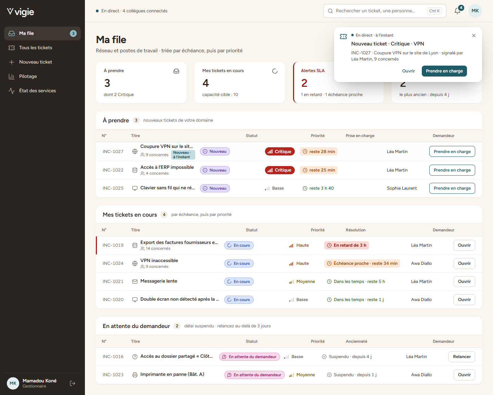
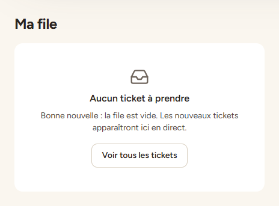
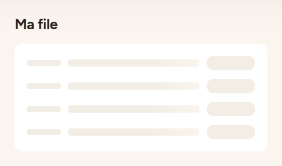
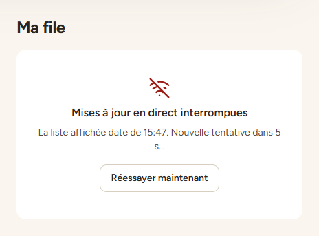

# 07 — À traiter (anciennement « À traiter »)

Route : `/ma-file` · Rôles : Gestionnaire, Administrateur · Story : VIGIE-31

| Vide                              | Chargement                              | Erreur (temps réel coupé)                            |
| --------------------------------- | --------------------------------------- | ---------------------------------------------------- |
|  |  |  |

Parcours cliquable : [parcours.md](parcours.md) (parcours 2).

## Mise en page

**En-tête** : à gauche « En direct · 4 collègues connectés » (point Pétrole 8 px, 13 `--color-neutral-700`,
écart 8) ; recherche 360 × 40 « Rechercher un ticket, une personne… » + touche « Ctrl K » (12 Taupe,
bordure Sable, rayon 4, marges 2 × 6) ; cloche ; avatar.

Contenu, colonne, écart 24 :

1. **Titre** (rangée `space-between`, alignée en bas) : « À traiter » (`.text-display-lg`) et sous-titre 15
   `--color-neutral-700` (écart 4) ; à droite le **groupe segmenté** « Confort / Dense » : fond
   `--color-neutral-100`, marges 3, rayon 10, écart 2 ; segment 32 px, marges 0 12, rayon 8, 13 px ;
   actif blanc 600 `--shadow-segment` ; inactif 500 Taupe.
2. **4 cartes KPI** : grille `repeat(4, minmax(0, 1fr))`, écart 24. Carte : marges 18 × 20, écart 8, rayon 14,
   `--shadow-xs`, liseré gauche 3 px (transparent, sauf « Alertes SLA » : `--color-sla-retard-fg`) ;
   libellé 13/600 + icône 18 à droite ; chiffre **32/36/600** tabulaire ; détail 13 `--color-neutral-700`.
   La carte « Alertes SLA » a libellé, icône et chiffre en `--color-sla-retard-fg`.
3. **3 sections** (carte blanche, rayon 14, `--shadow-xs`) : en-tête marges 16 × 20, écart 10 : titre 17/600,
   compteur (pastille 20 px, `--color-neutral-100`, 12/600).
   - **En-tête de tableau** 36 px, fond Lin, filets Sable, 12/600 Taupe.
   - **Grille des lignes** : `72px minmax(0, 1fr) 176px 88px 240px 110px auto`, écart 14, marges
     `4px 20px 4px 17px`, hauteur min. 44 (dense) / 52 (confort), liseré gauche 3 px (rouge si en retard),
     filet bas `--color-neutral-100`.
   - Cellules : numéro 13 Taupe ; icône du service 16 + titre 14/600 tronqué + méta 12 Taupe (`users` 13 +
     « 9 concernés ») ; PriorityBadge 24 ; SlaBadge 24 ; demandeur 13 ; action sm à droite.
   - Action : « Prendre en charge » = bouton 32 px blanc, texte et bordure `--color-brand-600` ;
     « Ouvrir » / « Relancer » = Secondaire sm.
   - Ligne arrivée en direct : étiquette « Nouveau · à l’instant » (11/700 `--color-brand-700` sur
     `--color-brand-200`, rayon 4, marges 1 × 6) + surbrillance `vigie-surbrillance`.
4. **Toast temps réel** en haut à droite (top 80, right 32) : voir [composants.md](composants.md), Toast.

## Sections et colonnes

| Section                 | Tri                             | Colonne SLA | Action par ligne                        |
| ----------------------- | ------------------------------- | ----------- | --------------------------------------- |
| À prendre               | prise en charge la plus proche  | Échéance    | Clic sur la ligne (⚠ 20/11)             |
| Mes tickets en cours    | par échéance, puis par priorité | Résolution  | Clic sur la ligne                       |
| En attente du demandeur | ancienneté                      | Ancienneté  | Clic sur la ligne (Relancer : VIGIE-21) |

## Textes exacts

- KPI : « À prendre » (`inbox`, « dont 2 Critique ») · « Mes tickets en cours » (`loader-circle`) · « Alertes SLA » (`clock`, « 1 en retard · 1 échéance proche ») · « En attente du demandeur » (`message-circle-question`, « le plus ancien : depuis 4 j »)
- Sections : « À prendre » · « Mes tickets en cours » · « En attente du demandeur »
- Colonnes : « N° » · « Titre » · « Priorité » · « Échéance » / « Résolution » / « Ancienneté » · « Demandeur »
- Actions : « Prendre en charge » · « Ouvrir » · « Relancer » ; étiquette « Nouveau · à l’instant »
- Toast : « En direct · à l’instant » · « Nouveau ticket · Critique · VPN » · « INC-1027 · Coupure VPN sur le site de Lyon · signalé par Léa Martin, 9 concernés » · « Ouvrir » (⚠ décision du 20/11 : le toast informe, il n’a pas de bouton « Prendre en charge » ; la prise en charge se fait depuis la ligne ou la fiche, où l’état réel du ticket est visible)
- Vide : `inbox` · « Aucun ticket à prendre » · « Bonne nouvelle : la file est vide. Les nouveaux tickets apparaîtront ici en direct. » · Secondaire « Voir tous les tickets »
- Erreur : `wifi-off` `--color-feedback-danger-fg` · « Mises à jour en direct interrompues » · « La liste affichée date de 15:47. Nouvelle tentative dans 5 s… » · Secondaire « Réessayer maintenant »

## États

| État       | Rendu                                                                                            |
| ---------- | ------------------------------------------------------------------------------------------------ |
| Vide       | Titre « À traiter » + carte EmptyState (marges 40 × 24).                                         |
| Chargement | Carte de 4 lignes squelettes : numéro 56 × 10, titre (reflet) 12 px, pastille 80 × 24.           |
| Erreur     | Socket.io coupé : la liste reste affichée avec son heure ; ErrorState + reconnexion automatique. |
| Temps réel | Nouveau ticket : toast **à tous les gestionnaires** + ligne surlignée 1,5 s dans « À prendre ».  |

## ⚠ Écarts avec les règles

- Sous-titre « Réseau et postes de travail · … » et « nouveaux tickets de votre domaine » : **une seule
  équipe support** → pas de filtre par domaine.
- Colonne « Prise en charge » avec « reste 28 min » : il n'existe qu'une échéance SLA (résolution, cadrage
  9.2) ; la colonne s'appelle « Échéance » et affiche le SlaBadge de l'échéance de résolution (décision 9.11).
- KPI « capacité cible : 10 » : aucune règle ne fixe cette cible ; à valider ou retirer.
- **Pas de « Prendre en charge » dans la liste ni dans le toast** (décision du 20/11) : aucun bouton dans les
  lignes : **un clic sur la ligne ouvre le ticket** ; le technicien lit le ticket puis s’assigne depuis la fiche (« Prendre en charge », VIGIE-7).
  Le toast informe seulement (« Ouvrir »).
- **Une seule densité** (décision du 20/11) : pas de groupe segmenté « Confort / Dense » ; les lignes ont la
  hauteur « Confort » (52 px).
- **Nom de l’écran** (décision du 20/11) : « À traiter » au lieu de « Ma file » (« file » se lit « fichier », et deux
  sections sur trois montrent les tickets de toute l’équipe). La route reste `/ma-file`.
- **Pas de sous-titre ni de description de section** (décision du 20/11) : la page n’affiche que « À traiter », puis
  pour chaque section son titre et son compteur.
- **Pas d’indicateur « En direct · N collègues connectés »** dans l’en-tête (décision du 20/11) : seul le bandeau
  « Mises à jour en direct interrompues » s’affiche, quand le temps réel est coupé.
- **Tri par colonne** (décision du 20/11, comme Zendesk ou Jira Service Management) : N°, Titre, Priorité,
  Échéance / Résolution / Ancienneté et Demandeur. Un clic trie (Priorité : Critique d’abord ; échéance la plus
  proche ou attente la plus ancienne d’abord), un deuxième inverse le sens, un troisième revient à l’ordre par
  défaut. Un seul critère à la fois, propre à chaque section ; flèche dans l’en-tête et `aria-sort`.
- **Pas de colonne Statut** (décision du 20/11) : chaque section ne contient qu’un statut (À prendre = Nouveau,
  Mes tickets en cours = En cours, En attente du demandeur = En attente), déjà dit par son titre.
- **Priorité Critique sans pastille pleine** et **échéance en texte court** (« Reste 2 h 09 », « Retard de 3 h »,
  « Depuis 4 j ») : décisions du 20/11, voir `docs/design-system.md`.
