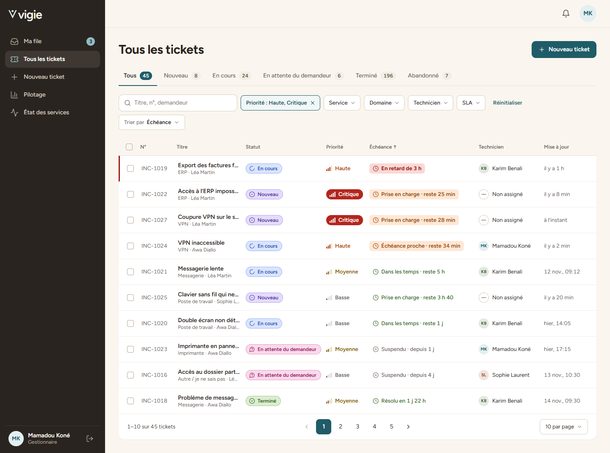
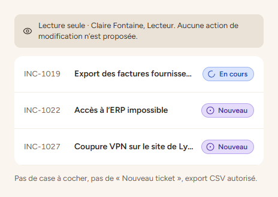
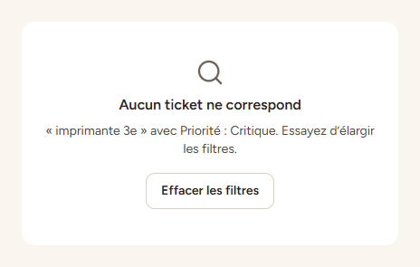

# 08 — Tous les tickets

Route proposée : `/tickets` · Rôles : Gestionnaire, Administrateur ; Lecteur en lecture seule

| Lecteur (lecture seule)                       | Aucun résultat                             |
| --------------------------------------------- | ------------------------------------------ |
|  |  |

## Mise en page

En-tête : cloche et avatar seulement. Contenu, colonne, **écart 20** :

1. **Titre** (rangée `space-between`) : « Tous les tickets » (`.text-display-lg`) + Primaire « Nouveau ticket »
   (`plus`). Absent pour le Lecteur.
2. **Onglets par statut** (Tabs) : filet bas Sable, écart 4 ; onglet 44 px, marges 0 12, écart 8, 14 px ;
   actif 600 Encre, souligné 2 px Pétrole, compteur blanc sur Pétrole ; inactif 500 Taupe, compteur
   `--color-neutral-700` sur `--color-neutral-100` ; survol fond `--color-neutral-100`.
3. **Barre de filtres** (FilterBar), retour à la ligne, écart 8 : recherche 280 × 40 ; puces 36 px (marges
   0 10 0 12, rayon 8, 13 px, `chevron-down` 14 Taupe) ; puce active bordure Pétrole, fond
   `--color-brand-50`, texte `--color-brand-700` 600 avec `x` ; Tertiaire « Réinitialiser » ; à droite
   « Trier par **Échéance** » (puce 36, « Trier par » Taupe, valeur 600).
4. **Tableau** : carte blanche, rayon 14, `--shadow-xs`.
   - Grille : `20px 72px minmax(0, 1fr) 176px 88px 244px 140px 104px`, écart 14, marges `0 20px 0 17px`.
   - En-tête 40 px, fond Lin, filet Sable, 12/600 Taupe ; case 16 px (rayon 4, bordure 1,5 px
     `--color-neutral-400`) ; colonne triée suivie de « ↑ ».
   - Ligne : hauteur min. 52 (confort) / 44 (dense), marges verticales 4, liseré gauche 3 px (rouge si en
     retard), filet bas `--color-neutral-100` ; titre 14/600 + « service · demandeur » 12 Taupe (tronqués) ;
     StatusBadge 24 ; PriorityBadge 24 ; SlaBadge 24 ; technicien Avatar 24 + nom 13 (« Non assigné » en
     avatar pointillé) ; mise à jour 13 Taupe tabulaire.
   - Pied (Pagination), marges 12 × 20 : « 1–10 sur 45 tickets » 13 `--color-neutral-700` ; pages 36 × 36,
     rayon 8, page courante Pétrole ; « 10 par page ».

États de ligne, sélection et focus : [composants.md](composants.md), TicketRow.

## Textes exacts

- Onglets : « Tous » · « Nouveau » · « En cours » · « En attente du demandeur » · « Terminé » · « Abandonné » (+ compteurs)
- Recherche : « Titre, n°, demandeur » ; filtres « Priorité » · « Service » · « Domaine » · « Technicien » · « SLA » ; puce active « Priorité : Haute, Critique » ; « Réinitialiser » ; « Trier par Échéance »
- Colonnes : « N° » · « Titre » · « Statut » · « Priorité » · « Échéance » · « Technicien » · « Mise à jour »
- SLA d'un ticket terminé : « Résolu en 1 j 22 h » (durée, sans badge de niveau)
- Pagination : « 1–10 sur 45 tickets » · « 10 par page »
- Lecteur : bandeau « Lecture seule · Claire Fontaine, Lecteur. Aucune action de modification n’est proposée. »
- Aucun résultat : `search` 32 Taupe · « Aucun ticket ne correspond » · « « imprimante 3e » avec Priorité : Critique. Essayez d’élargir les filtres. » · Secondaire « Effacer les filtres »

## Variante Lecteur

Bandeau : fond `--color-neutral-200`, rayon 10, marges 10 × 14, écart 10, `eye` 16, 13/18
`--color-neutral-800`. Pas de case à cocher, pas de « Nouveau ticket », pas d'action de modification.

## États

| État       | Rendu                                                                           |
| ---------- | ------------------------------------------------------------------------------- |
| Vide       | Aucun résultat avec les filtres : EmptyState ci-dessus.                         |
| Chargement | Lignes squelettes (voir TicketRow, état chargement).                            |
| Erreur     | ErrorState « Impossible de charger les tickets » + « Réessayer » (non dessiné). |
| Temps réel | Compteurs des onglets et lignes mis à jour en direct, ligne modifiée surlignée. |

## ⚠ Écarts avec les règles

- « Prise en charge · reste 25 min » sur les tickets Nouveau : une seule échéance SLA (cadrage 9.2).
- Lecteur : « export CSV autorisé » dans la maquette, sans story.
