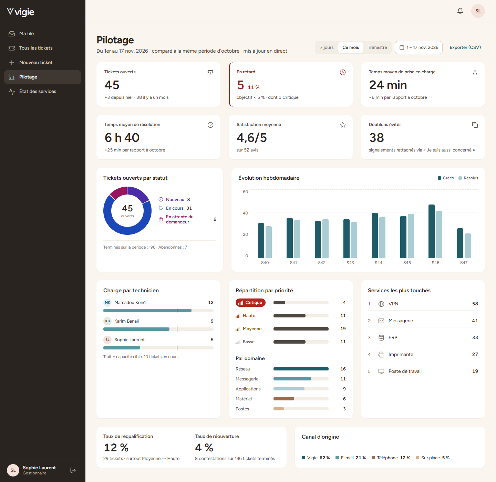
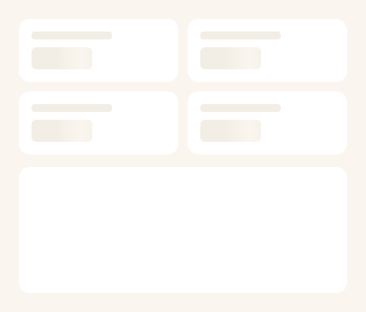
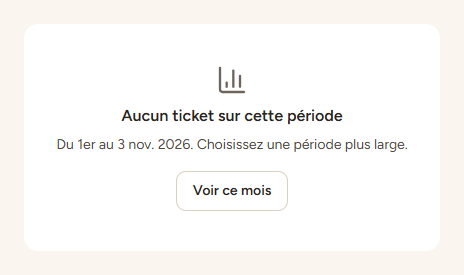
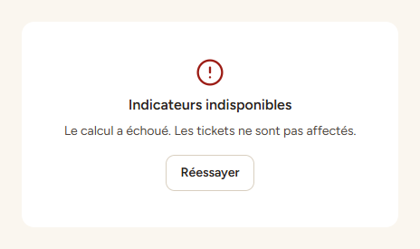

# 09 — Pilotage

Route : `/pilotage` · Rôles : Gestionnaire, Administrateur, Lecteur · Story : VIGIE-32

| Chargement                               | Aucune donnée                               | Erreur                               |
| ---------------------------------------- | ------------------------------------------- | ------------------------------------ |
|  |  |  |

## Mise en page

En-tête : cloche et avatar. Contenu, colonne, écart 24 :

1. **Titre** (rangée `space-between`, alignée en bas) : « Pilotage » + sous-titre 15 `--color-neutral-700` ;
   à droite, écart 8 : groupe segmenté « 7 jours / Ce mois / Trimestre », sélecteur de dates
   38 px (`calendar` 15, rayon 10, 13 px), Tertiaire « Exporter (CSV) » 38 px (voir ⚠).
2. **6 cartes KPI** : grille `repeat(3, minmax(0, 1fr))`, écart 24 (2 rangées). Carte : marges 20, écart 8,
   rayon 14, `--shadow-xs`, liseré gauche 3 px (seulement « En retard », `--color-sla-retard-fg`) ;
   libellé 13/600 + icône 18 ; chiffre **36/40/600** + valeur secondaire 15/600 (taux) ; détail 13
   `--color-neutral-700`. La carte « En retard » est entièrement en `--color-sla-retard-fg`.
3. **Grille `minmax(0, 4fr) minmax(0, 8fr)`**, écart 24 :
   - « Tickets ouverts par statut » : anneau 140 px (trou 94 px, total 26/600 + « ouverts » 11 Taupe),
     couleurs **de statut** séparées par un fin blanc ; légende colonne écart 10, 13 px : icône 14 + libellé
     600 dans la couleur du statut + nombre en Encre ; pied 12 Taupe sous un filet.
   - « Évolution hebdomadaire » : légende 12 (pastilles 10 px, rayon 3) ; graphique 220 px, axe 28 px
     (12 Taupe, aligné à droite) ; grille pointillée `--color-neutral-200`, ligne de base pleine
     `--color-neutral-300` ; 8 semaines, 2 barres de 18 px (rayon 4 4 0 0) : Créés `--color-chart-1`,
     Résolus `--color-chart-3` ; étiquettes 12 Taupe.
4. **Grille de 3 cartes** (`repeat(3, …)`, écart 24) :
   - « Charge par technicien » : Avatar 24 + nom 13 + valeur 600 ; barre 10 px (fond
     `--color-neutral-100`, valeur `--color-chart-2`, rayon 4) ; trait cible 2 × 16 Encre ; note 12 Taupe.
   - « Répartition par priorité » : grille `100px minmax(0, 1fr) 40px`, écart 10 ; PriorityBadge 24 ; barre
     10 px `--color-chart-6` ; nombre 600. Puis « Par domaine » (15/600 sous un filet) : barres aux couleurs
     `--color-chart-1` à `-5`.
   - « Services les plus touchés » : lignes 36 px (filet bas), rang 13 Taupe, icône du service 18, nom, valeur 600.
5. **Grille de 2 cartes** (`repeat(2, …)`, écart 24) :
   - Taux (grille 2 colonnes, écart 20) : libellé 14/600 `--color-neutral-700`, chiffre 32/36/600, détail 13.
   - « Canal d’origine » : barre empilée 16 px (rayon 4, écart 2) + légende 13 (pastille 10 px, valeur
     tabulaire) ; couleurs `--color-chart-1`, `-2`, `-4`, `-5`.

## Textes exacts

- Sous-titre (exemple) : « Du 1er au 17 nov. 2026 · comparé à la même période d’octobre · mis à jour en direct »
- Période : « 7 jours » · « Ce mois » · « Trimestre » ; dates « 1 – 17 nov. 2026 »
- KPI : « Tickets ouverts » (`ticket`, « +3 depuis hier · 38 il y a un mois ») · « En retard » (`clock`, taux « 11 % », « objectif < 5 % · dont 1 Critique ») · « Temps moyen de prise en charge » (`user`, « −6 min par rapport à octobre ») · « Temps moyen de résolution » (`circle-check`) · « Satisfaction moyenne » (`star`, « 4,6/5 », « sur 52 avis ») · « Doublons évités » (`copy`, « signalements rattachés via « Je suis aussi concerné » »)
- Graphiques : « Tickets ouverts par statut » (« ouverts », « Terminés sur la période : 196 · Abandonnés : 7 ») · « Évolution hebdomadaire » (« Créés », « Résolus », semaines « S40 »…) · « Charge par technicien » (« Trait = capacité cible, 10 tickets en cours. ») · « Répartition par priorité » · « Par domaine » · « Services les plus touchés » · « Taux de requalification » (« 29 tickets · surtout Moyenne → Haute ») · « Taux de réouverture » (« 8 contestations sur 196 tickets terminés ») · « Canal d’origine » (Vigie · E-mail · Téléphone · Sur place)
- Aucune donnée : `chart-column` 32 Taupe · « Aucun ticket sur cette période » · « Du 1er au 3 nov. 2026. Choisissez une période plus large. » · Secondaire « Voir ce mois »
- Erreur : `circle-alert` 32 `--color-feedback-danger-fg` · « Indicateurs indisponibles » · « Le calcul a échoué. Les tickets ne sont pas affectés. » · Secondaire « Réessayer »

## États

| État       | Rendu                                                                                                         |
| ---------- | ------------------------------------------------------------------------------------------------------------- |
| Chargement | Cartes KPI squelettes (libellé 60 % × 10, chiffre 45 % × 28 avec reflet) + cartes de graphiques vides 160 px. |
| Vide       | « Aucun ticket sur cette période ».                                                                           |
| Erreur     | « Indicateurs indisponibles » (calcul en échec).                                                              |
| Temps réel | Chiffres mis à jour en direct (room `pilotage`).                                                              |

## ⚠ Écarts avec les règles

- « Par domaine » : libellés de `libelles.js` (Réseau, Infrastructure, Applicatif, Base de données, À qualifier),
  pas « Messagerie, Applications, Matériel, Postes ».
- « Exporter (CSV) » et la capacité cible de 10 tickets : sans story ni règle.
