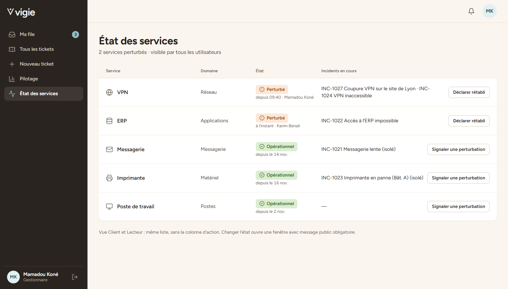

# 10 — État des services

Route proposée : `/services` · Rôles : tous (action réservée au Gestionnaire et à l'Administrateur)

> ⚠ Fonctionnalité **sans story** (cadrage 9.9) : à ne coder qu'une fois la story créée et priorisée.
> L'entrée « État des services » de la barre latérale n'apparaît qu'à ce moment-là.

## Mise en page

En-tête : cloche et avatar. Contenu, colonne, écart 24 :

1. Titre « État des services » (`.text-display-lg`) + sous-titre 15 `--color-neutral-700` (écart 4).
2. **Tableau** (carte blanche, rayon 14, `--shadow-xs`) :
   - grille `minmax(0, 1.3fr) 140px 170px minmax(0, 1.6fr) 150px`, écart 16, marges 0 20 ;
   - en-tête 40 px fond Lin, 12/600 Taupe ;
   - ligne : hauteur min. 64, marges 8 × 20, filet bas `--color-neutral-100` ;
     service = icône 20 Taupe + nom 15/600 ; domaine 14 `--color-neutral-700` ;
     état = badge (voir [02](02-mes-demandes.md) : Opérationnel / Perturbé) + « depuis … » 12 Taupe ;
     incidents en cours 14/20 ; action = bouton Secondaire sm aligné à droite.
   - ligne qui vient de changer : surbrillance `vigie-surbrillance`.
3. Note 13 Taupe sous le tableau.

## Textes exacts

- Sous-titre : « 2 services perturbés · visible par tous les utilisateurs »
- Colonnes : « Service » · « Domaine » · « État » · « Incidents en cours »
- États : « Opérationnel » · « Perturbé » ; détail « depuis 09:40 · Mamadou Koné », « à l’instant · Karim Benali », « depuis le 14 nov. »
- Incidents : « INC-1027 Coupure VPN sur le site de Lyon · INC-1024 VPN inaccessible » ; « (isolé) » pour un ticket seul ; « — » s'il n'y en a pas
- Actions : « Déclarer rétabli » (service perturbé) · « Signaler une perturbation » (service opérationnel)
- Règle d'affichage : « Vue Client et Lecteur : même liste, sans la colonne d’action. Changer l’état ouvre une fenêtre avec message public obligatoire. »

## États

| État       | Rendu                                                                                         |
| ---------- | --------------------------------------------------------------------------------------------- |
| Chargement | Lignes squelettes.                                                                            |
| Erreur     | ErrorState + « Réessayer ».                                                                   |
| Temps réel | `service:status` : la ligne change d'état et se surligne ; notification de type « Services ». |

## ⚠ Écarts avec les règles

- Domaines « Applications », « Matériel », « Postes » → libellés de `libelles.js`.
- Le modèle `Service` n'a pas de champ d'état, et `TYPES_NOTIFICATION` pas de type « services ».
