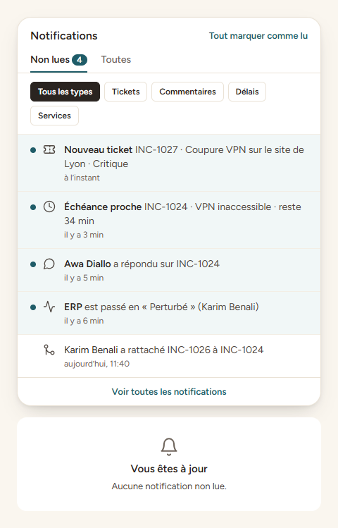

# 11 — Notifications

Panneau ouvert depuis la cloche de l'en-tête · Rôles : tous

## Mise en page (NotificationPanel)

Panneau **420 px** (432 avec sa bordure), fond blanc, bordure Sable, rayon 20, `--shadow-md`, ancré sous la cloche.

1. En-tête, marges `16px 18px 8px`, `space-between` : « Notifications » 16/600 · lien « Tout marquer comme lu »
   13/600 Pétrole.
2. Onglets, marges 0 18, écart 20, filet bas Sable, 14 px : actif 600 souligné 2 px Pétrole avec compteur
   (12 px, marges 1 × 7, blanc sur Pétrole) ; inactif 500 Taupe.
3. Filtres par type, marges 12 × 18, écart 6, retour à la ligne : puces 28 px, marges 0 10, rayon 6,
   12/600 ; active : fond et bordure `--color-neutral-900`, texte blanc ; sinon blanc, bordure Sable.
4. Liste : ligne grille `8px 20px minmax(0, 1fr)`, écart 10, marges 12 × 18, filet haut `--color-neutral-100` ;
   point 8 px Pétrole (non lue) ; icône 18 `--color-neutral-700` ; texte 14/20, auteur ou type en 600 (non
   lue) / 400 (lue), suite en 400 `--color-neutral-700` ; date 12 Taupe. **Non lue : fond `--color-brand-50`.**
5. Pied, marges 12 × 18, filet haut Sable, centré : « Voir toutes les notifications » 13/600 Pétrole.

Cloche (NotificationBell) : bouton 40, icône 20 ; compteur Pétrole 18 px (11/700, anneau 2 px du fond),
plafond « 99+ » ; **jamais rouge**. Ouverte : fond `--color-brand-100`, icône Pétrole.

## Textes exacts

- « Notifications » · « Tout marquer comme lu » · « Non lues » · « Toutes »
- Filtres : « Tous les types » · « Tickets » · « Commentaires » · « Délais » · « Services »
- Exemples de lignes : « **Nouveau ticket** INC-1027 · Coupure VPN sur le site de Lyon · Critique » (`ticket`) ·
  « **Échéance proche** INC-1024 · VPN inaccessible · reste 34 min » (`clock`) · « **Awa Diallo** a répondu sur INC-1024 » (`message-circle`) ·
  « **ERP** est passé en « Perturbé » (Karim Benali) » (`activity`) · « **Karim Benali** a rattaché INC-1026 à INC-1024 » (`git-merge`)
- « Voir toutes les notifications »
- Vide : `bell` 28 · « Vous êtes à jour » (15/600) · « Aucune notification non lue. » (13) — carte marges 28 × 20, écart 8.

## Règles

- Chaque notification est enregistrée en base puis émise (`notification:nouvelle`, room `user:<id>`) ; à la
  (re)connexion, les non lues sont relues par l'API (cadrage 5).
- Correspondance des filtres (proposition, à valider) : Tickets = nouveau ticket, mise à jour, changement de statut ; Commentaires =
  nouveau commentaire, attente de réponse ; Délais = `ALERTE_SLA`, `RELANCE` ; Services = état des services (VIGIE-42).
