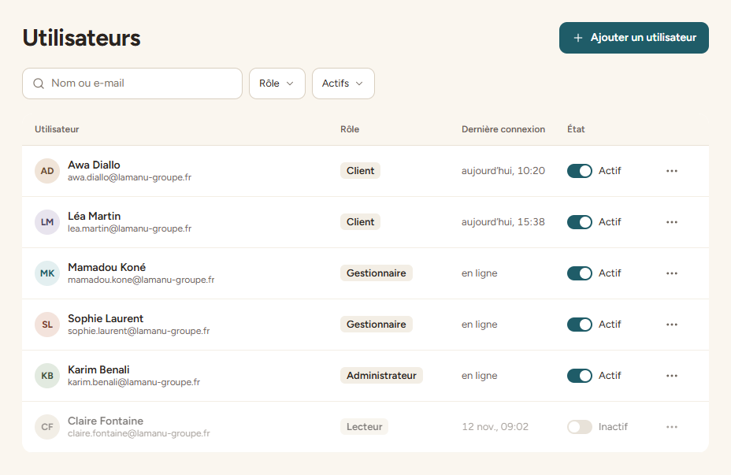
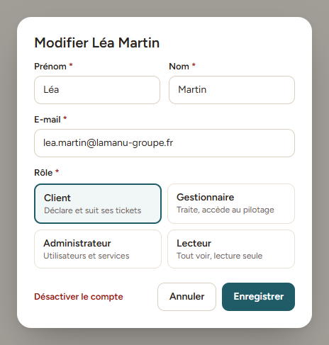
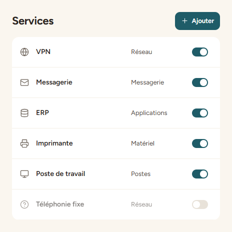

# 12 — Administration

Routes proposées : `/administration/utilisateurs`, `/administration/services` (aujourd'hui `/administration`) ·
Rôle : Administrateur · Stories : VIGIE-37 (utilisateurs), VIGIE-4 (catalogue de services)

| Modifier un utilisateur                      | Services                                     |
| -------------------------------------------- | -------------------------------------------- |
|  |  |

Barre latérale de l'Administrateur : section « Administration » avec « Utilisateurs » et « Services »
(voir `/styleguide`).

## Utilisateurs

Contenu, colonne, écart 18 :

1. Titre « Utilisateurs » (`.text-display-lg`) + Primaire « Ajouter un utilisateur » (`plus`).
2. Filtres, écart 8 : recherche 280 × 40 « Nom ou e-mail » ; listes 40 px « Rôle », « Actifs » (13 px, `chevron-down` 14).
3. Tableau (carte blanche, rayon 14) : grille `minmax(0, 1.6fr) 140px 120px 110px 40px`, écart 14, marges 0 16 ;
   en-tête 40 px fond Lin 12/600 Taupe ; ligne hauteur min. 56, filet bas :
   - utilisateur : Avatar 32 + nom 14/600 + e-mail 12 Taupe tronqué ;
   - rôle : étiquette 13/600, marges 3 × 8, rayon 6, fond `--color-neutral-100` ;
   - dernière connexion 13 Taupe tabulaire (« en ligne », « aujourd’hui, 10:20 », « 12 nov., 09:02 ») ;
   - état : **interrupteur** 32 × 18 (rond blanc 14, marge 2) — actif `--color-brand-600`, inactif
     `--color-neutral-300` — + « Actif » / « Inactif » 13 ;
   - menu `ellipsis` 18 Taupe.
   - Ligne d'un compte inactif : opacité 0,6 ; rond de l'interrupteur à gauche (2 px), actif à droite (16 px).

### Fenêtre « Modifier un utilisateur »

Modal 480 (rayon 20, marges 24, écart 14, `--shadow-lg`, voile `--color-overlay`) :
titre « Modifier Léa Martin » 20/600 ; « Prénom * » et « Nom * » en grille 2 colonnes (écart 12) ;
« E-mail * » ; « Rôle * » en **4 cartes** (grille 2 × 2, écart 8 ; marges 10 × 12, rayon 10 ; libellé 14/600 +
description 12 Taupe ; choisie : bordure 2 px Pétrole, fond `--color-brand-50`) ; pied `space-between` :
lien « Désactiver le compte » 13/600 `--color-feedback-danger-fg` · Secondaire « Annuler » · Primaire « Enregistrer ».
Désactiver ouvre la Modal destructive ([composants.md](composants.md)).

## Services

Titre « Services » (22/700, approche -0.02em) + Primaire sm « Ajouter » (36 px, `plus` 15).
Liste (carte blanche, rayon 14) : grille `20px minmax(0, 1fr) 110px 40px`, écart 12, hauteur min. 52, marges
4 × 16 : icône du service 18 Taupe ; nom 14/600 ; domaine 13 `--color-neutral-700` ; interrupteur actif / inactif.

## Textes exacts

- « Utilisateurs » · « Ajouter un utilisateur » · « Nom ou e-mail » · « Rôle » · « Actifs »
- Colonnes : « Utilisateur » · « Rôle » · « Dernière connexion » · « État » ; « Actif » · « Inactif »
- Rôles (cartes) : Client « Déclare et suit ses tickets » · Gestionnaire « Traite, accède au pilotage » · Administrateur « Utilisateurs et services » · Lecteur « Tout voir, lecture seule »
- « Modifier Léa Martin » · « Prénom * » · « Nom * » · « E-mail * » · « Rôle * » · « Désactiver le compte » · « Annuler » · « Enregistrer »
- Désactivation : « Désactiver le compte de Léa Martin ? » · « Léa Martin ne pourra plus se connecter. Ses 3 tickets ouverts restent visibles et suivis par le support. Vous pourrez réactiver le compte. » · case « Prévenir Léa Martin par e-mail » · Danger « Désactiver le compte »
- « Services » · « Ajouter »

## ⚠ Écarts avec les règles

- Domaines « Applications », « Matériel », « Postes » → libellés de `libelles.js`. « Téléphonie fixe » est une donnée de démonstration.
