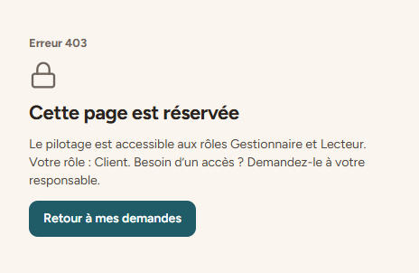
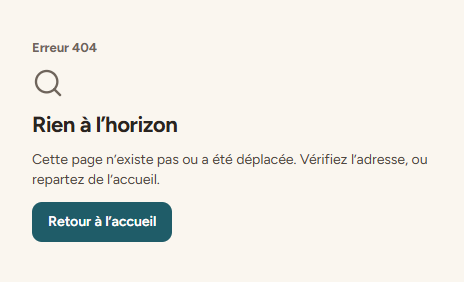

# 13 — Erreurs 403 et 404

Rôles : tous. La maquette ne montre que le contenu : on propose de l'afficher dans le gabarit connecté
(barre latérale du rôle) quand l'utilisateur est connecté.

| 403 — accès refusé       | 404 — page introuvable   |
| ------------------------ | ------------------------ |
|  |  |

## Mise en page

Contenu aligné à gauche, colonne, écart 12, marges 40 × 32 :
code « Erreur 403 » 13/700 Taupe tabulaire ; icône 32 Taupe (`lock` / `search`) ; titre 22/700, approche
-0.02em ; texte 14/20 `--color-neutral-700`, largeur max. 400 ; bouton Primaire.

## Textes exacts

- 403 : « Erreur 403 » · « Cette page est réservée » · « Le pilotage est accessible aux rôles Gestionnaire, Administrateur et Lecteur. Votre rôle : Client. Besoin d’un accès ? Demandez-le à votre responsable. » · « Retour à mes demandes »
- 404 : « Erreur 404 » · « Rien à l’horizon » · « Cette page n’existe pas ou a été déplacée. Vérifiez l’adresse, ou repartez de l’accueil. » · « Retour à l’accueil »

Le texte 403 s'adapte à la page demandée et au rôle (libellés de `libelles.js`). Le bouton mène à l'accueil
du rôle (`accueilDuRole`).

## ⚠ Écarts avec les règles

- La maquette dit « Gestionnaire et Lecteur » : l'Administrateur a aussi accès au pilotage (texte corrigé ci-dessus).
- Un ticket non autorisé n'affiche pas une 403 mais le message « Ce ticket n’existe plus ou ne vous est pas
  accessible » ([05](05-fiche-ticket-client.md)), pour ne pas révéler son existence.
