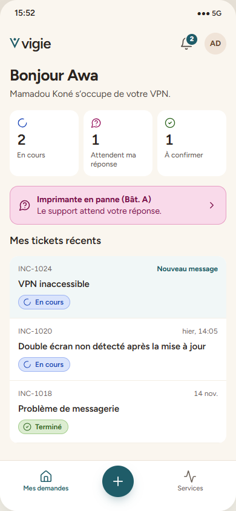
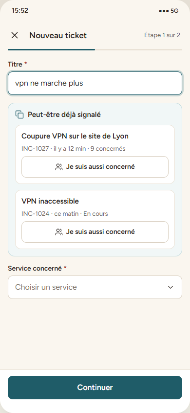
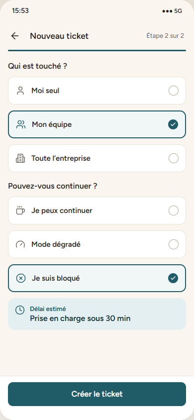
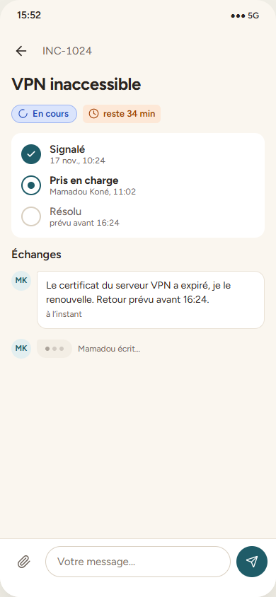
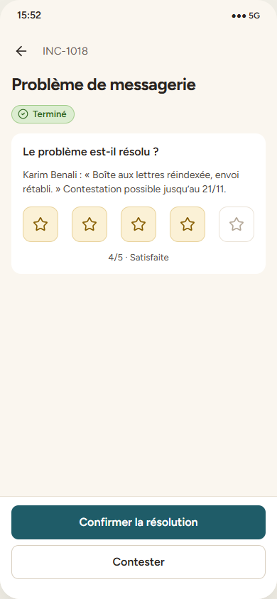

# 14 — Mobile (390 px)

Rôle : Client · Écran de référence 390 × 844. Mêmes routes que le bureau ; la mise en page change sous ~768 px.

| Mes demandes                             | Créer · étape 1                                     | Créer · étape 2                                     |
| ---------------------------------------- | --------------------------------------------------- | --------------------------------------------------- |
|  |  |  |

| Fiche ticket · temps réel                       | Fiche ticket · terminé                                  |
| ----------------------------------------------- | ------------------------------------------------------- |
|  |  |

La barre d'état « 15:52 ●●● 5G » (44 px) fait partie de la maquette du téléphone : ne pas la coder.

## Règles communes

- **Cibles tactiles ≥ 44 px** ; champs et boutons principaux de **48 px**, texte des champs **16 px** (évite le
  zoom automatique).
- Marges latérales 16 px. Pas de barre latérale.
- Barre haute 56 px, marges 0 16 (écrans d'étape : 0 8) ; barre basse ou pied collant fond blanc, filet haut Sable.

## Mes demandes

- Barre haute : logo « vigie » 24 px (flexible) · cloche 44 × 44 (icône 22, compteur à top 6 / right 4) · Avatar 36.
- Contenu, marges `8px 16px 16px`, colonne écart 16 :
  - « Bonjour Awa » 26/32/700 + phrase 15/22 `--color-neutral-700` (écart 4) ;
  - 3 cartes `repeat(3, 1fr)`, écart 8 : marges 12, rayon 14, écart 4 ; icône 18 couleur du statut ; chiffre
    24/600 ; libellé 12/15 `--color-neutral-700` (« En cours » · « Attendent ma réponse » · « À confirmer ») ;
  - bandeau « en attente » : fond `--color-status-en-attente-bg`, bordure `-border`, rayon 14, marges
    12 × 14, écart 10, texte 14/19 `--color-status-en-attente-strong`, `message-circle-question` 20,
    `chevron-right` 18 : « **Imprimante en panne (Bât. A)** Le support attend votre réponse. » ;
  - « Mes tickets récents » 17/600 ; liste (carte blanche, rayon 14) : ligne marges 14, écart 8, filet bas ;
    numéro + date 12 Taupe (« Nouveau message » en Pétrole 600 sur une ligne à fond `--color-brand-50`) ;
    titre 15/20/600 ; StatusBadge 24.
- **Barre d'onglets basse 84 px** (marges `8px 16px 24px`) : grille 3 colonnes ; « Mes demandes » (`house` 22,
  11/600 Pétrole, actif) · bouton central **« + » 52 × 52** rond Pétrole, icône 24, `--shadow-fab` ·
  « Services » (`activity` 22, 11/500 Taupe).

## Créer un ticket (2 étapes)

- Barre haute : `x` (étape 1) ou `arrow-left` (étape 2) en 44 × 44 · « Nouveau ticket » 17/600 · « Étape 1 sur 2 » 13 Taupe.
- Progression : trait 3 px `--color-neutral-200` (marges 0 16, rayon 3), rempli `--color-brand-600` à 50 % puis 100 %.
- Contenu, marges 20 × 16, colonne écart 16 (étape 2 : 12) :
  - étape 1 : « Titre * » (libellé 14/600, champ 48) ; panneau « Peut-être déjà signalé » (marges 14, écart 12 ;
    cartes marges 12, rayon 12 ; bouton **pleine largeur 44 px** « Je suis aussi concerné ») ; « Service
    concerné * » en liste 48 px « Choisir un service ».
  - étape 2 : questions 16/600 ; **cartes de choix en liste** (une par ligne) : hauteur min. 56, marges 10 × 14,
    rayon 12, écart 12, icône 20, titre 15/600, rond 20 à droite ; délai estimé (fond `--color-brand-100`,
    marges 14, écart 10, `clock` 20, « Délai estimé » 13/600, valeur 16/600).
- **Pied collant** : marges `12px 16px 28px` ; Primaire pleine largeur 48 px, 16/600 (« Continuer », « Créer le ticket »).

## Fiche ticket Client

- Barre haute : `arrow-left` 44 × 44 · numéro « INC-1024 » 15 Taupe.
- Contenu, marges `4px 16px 16px`, colonne écart 14 : titre 24/30/700 ; StatusBadge 26 + SlaBadge court 26 ;
  suivi **vertical** (carte marges 14, écart 12 ; rond 28 + libellé 15 + date 12 Taupe) ; « Échanges » 16/600 ;
  bulles avec avatar 28 (marges 10 × 12) ; « Mamadou écrit… » 12 Taupe.
- **Champ de réponse collant** : marges `10px 12px 28px`, écart 8 ; `paperclip` 44 × 44 ; champ 44 px rayon 22
  (pilule), 15 px, « Votre message… » ; bouton d'envoi rond 44 Pétrole, icône 18.
- Terminé : « Le problème est-il résolu ? », message de clôture, étoiles et « 4/5 · Satisfaite », boutons
  « Confirmer la résolution » / « Contester » pleine largeur (voir capture).

## ⚠ Écarts avec les règles

Les mêmes que le bureau : « Contestation possible jusqu’au 21/11 » → 15 jours ; « Peut-être déjà signalé » :
méta limitée au service et à la date (« INC-1027 · il y a 12 min · VPN ») ; « Prise en charge sous 30 min » :
voir [03](03-creer-un-ticket.md).
