# Composants

Catalogue des composants du design system. **Fait** = codé dans `client/src/composants/` et visible sur
`/styleguide` (en développement) : c'est alors le code qui fait foi. **À faire** = à construire d'après cette
fiche et sa capture, puis à ajouter à `/styleguide`.

États génériques : par défaut · survol · focus clavier · actif · désactivé · erreur · chargement.
Couleurs : uniquement les tokens de `client/src/styles/tokens.css`.

| Composant                                                  | État     | Capture                                           |
| ---------------------------------------------------------- | -------- | ------------------------------------------------- |
| Button, IconButton                                         | **Fait** | `composants-03-boutons.png`                       |
| StatusBadge, PriorityBadge, SlaBadge                       | **Fait** | voir `/styleguide`                                |
| Avatar                                                     | **Fait** | `composants-03-echanges.png`                      |
| Sidebar (barre haute sous 768 px)                          | **Fait** | `composants-03-barre-laterale-et-en-tete.png`     |
| TextField, TextArea (SearchField, FileDrop : à faire)      | **Fait** | `composants-03-champs.png`                        |
| ServiceSelect                                              | À faire  | `composants-03-liste-de-choix.png`                |
| ChoiceCard (ChoiceGroup), DelayEstimate                    | **Fait** | `composants-03-cartes-impact-et-urgence.png`      |
| DuplicatePanel                                             | À faire  | `composants-03-suggestion-de-doublon.png`         |
| TicketRow                                                  | À faire  | `composants-03-ligne-de-ticket.png`               |
| TicketCard                                                 | À faire  | `composants-03-carte-de-ticket.png`               |
| ProgressTracker                                            | À faire  | `composants-03-suivi-davancement.png`             |
| TimelineItem                                               | À faire  | `composants-03-frise.png`                         |
| CommentBubble, TypingIndicator, PresenceAvatars            | À faire  | `composants-03-echanges.png`                      |
| NotificationBell, NotificationPanel                        | À faire  | `composants-03-notifications.png`                 |
| Toast                                                      | À faire  | `composants-03-toasts.png`                        |
| Tabs, FilterBar, Pagination                                | À faire  | `composants-03-onglets-filtres-pagination.png`    |
| KpiCard                                                    | À faire  | `composants-03-chiffres-cles.png`                 |
| Charts                                                     | À faire  | `composants-03-graphiques.png`                    |
| Modal                                                      | À faire  | `composants-03-modales.png`                       |
| EmptyState, ErrorState, Skeleton                           | **Fait** | `composants-03-etats-vides-erreur-chargement.png` |
| PageHeader (retour + avatar ; recherche, cloche : à faire) | **Fait** | `composants-03-barre-laterale-et-en-tete.png`     |

---

## Champs — TextField, TextArea, SearchField, FileDrop

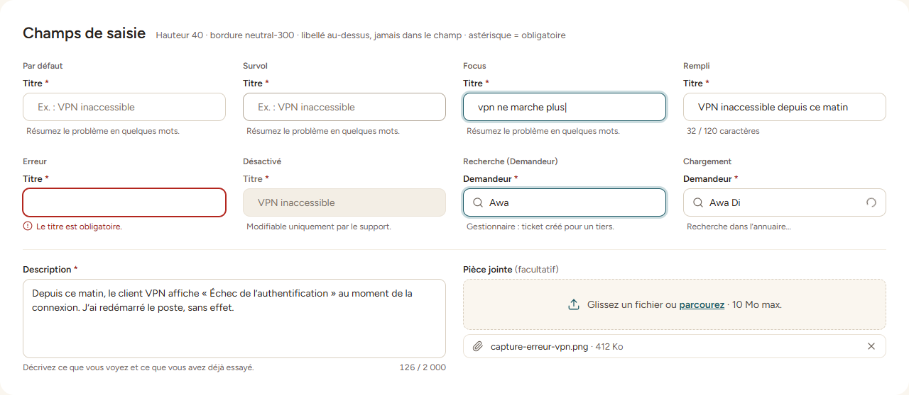

- Hauteur 40 (44 dans les formulaires de création, 48 sur mobile), marges 0 12, rayon `--radius-md`, fond blanc,
  bordure 1 px `--color-neutral-300`, texte 14 ; libellé **au-dessus**, jamais dans le champ, 13/600, écart 6 ;
  astérisque `--color-feedback-danger-fg` ; aide 12/16 Taupe ; placeholder `--color-neutral-500`.
- Survol : bordure `--color-neutral-400`. Focus : bordure `--color-brand-600` + `--shadow-field-focus`.
- Erreur : bordure `--color-danger-button` + `0 0 0 1px` de la même couleur ; message 12/16
  `--color-feedback-danger-fg` avec `circle-alert` 14, écart 5.
- Désactivé : fond `--color-neutral-100`, bordure `--color-neutral-200`, texte et libellé `--color-neutral-500`.
- Chargement (recherche) : `search` 16 Taupe à gauche, `loader-circle` tournant à droite.
- TextArea : hauteur min. 112, marges 10 × 12, 14/20 ; compteur à droite de l'aide (« 126 / 2 000 »).
- FileDrop : 72 px (64 dans le formulaire), bordure `1.5px dashed --color-neutral-300`, fond Lin, `upload` 18
  Pétrole, « parcourez » souligné Pétrole 600 ; fichier ajouté : ligne bordée Sable, rayon 10, marges 8 × 12,
  `paperclip` 16, nom, « · 412 Ko » Taupe, `x` 16.
- Textes : « Résumez le problème en quelques mots. » · « 32 / 120 caractères » · « Le titre est obligatoire. » ·
  « Modifiable uniquement par le support. » · « Recherche dans l’annuaire… »

## ServiceSelect

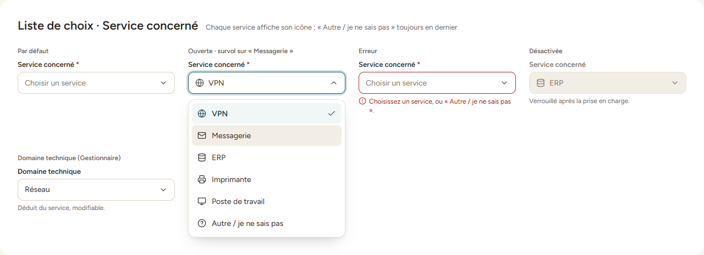

Liste 40 px avec icône du service ; menu : bordure Sable, rayon 12, marges 6, écart 2, `--shadow-md` ; option
38 px, marges 0 10, rayon 8, écart 10, icône 16 ; survol `--color-neutral-100` ; choisie fond `--color-brand-50`,
texte `--color-brand-700` 600 + `check` Pétrole. Erreur : bordure 1,5 px `--color-danger-button`, « Choisissez un
service, ou « Autre / je ne sais pas ». » Désactivée : « Verrouillé après la prise en charge. » Variante
« Domaine technique » (Gestionnaire) : « Déduit du service, modifiable. » « Autre / je ne sais pas » toujours en dernier.

## ChoiceCard et DelayEstimate

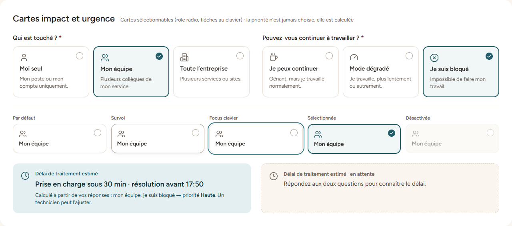

- ChoiceCard : `role="radio"`, flèches au clavier ; hauteur min. 112, marges 16, rayon 14, écart 8, icône 22,
  titre 15/600, description 13/18 Taupe, rond 18 en haut à droite. Défaut : bordure Sable, `--shadow-xs`, icône
  Taupe, rond bordé 1,5 px `--color-neutral-400`. Survol : bordure `--color-neutral-400` + `--shadow-sm`. Focus :
  `--shadow-focus-on-surface`. Choisie : bordure 2 px `--color-brand-600`, fond `--color-brand-50`, icône Pétrole,
  rond plein Pétrole + coche blanche (trait 3). Désactivée : opacité 0,5, fond Lin.
- Descriptions : « Mon poste ou mon compte uniquement. » · « Plusieurs collègues de mon service. » · « Plusieurs
  services ou sites. » · « Gênant, mais je travaille normalement. » · « Je travaille, plus lentement ou autrement. » ·
  « Impossible de faire mon travail. »
- DelayEstimate calculé : voir [03](03-creer-un-ticket.md). En attente : fond Lin, bordure `1px dashed
--color-neutral-300`, `clock` Taupe, « Délai de traitement estimé · en attente » 13/600 Taupe, « Répondez aux
  deux questions pour connaître le délai. » 15/22 `--color-neutral-700`.

## DuplicatePanel

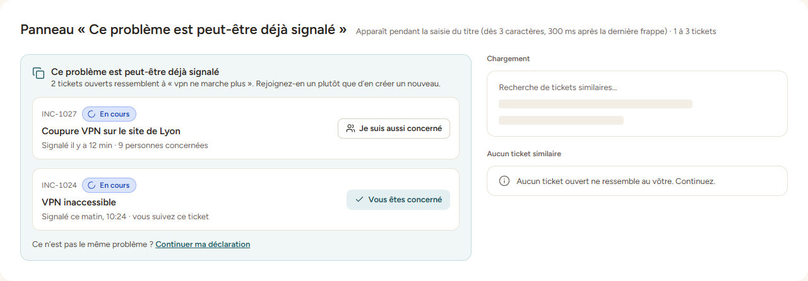

Voir [03](03-creer-un-ticket.md). Chargement : bordure Sable, rayon 14, marges 18, « Recherche de tickets
similaires… » 13 Taupe + 2 squelettes (70 % et 45 %, 14 px). Aucun résultat : `info` 18, « Aucun ticket ouvert
ne ressemble au vôtre. Continuez. »

## TicketRow

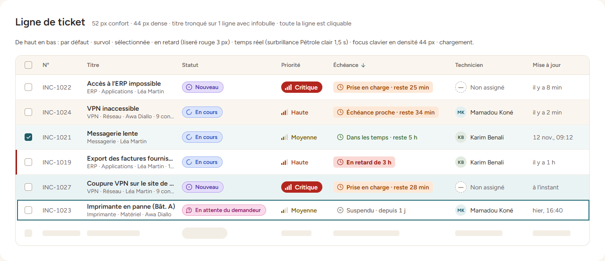

Grille et cellules : [08](08-tous-les-tickets.md). États : défaut ; survol fond Lin ; sélectionnée fond
`--color-brand-50` + case cochée Pétrole ; **en retard** liseré gauche 3 px `--color-sla-retard-fg` ; **temps réel**
surbrillance `--color-highlight` → blanc en `--duration-highlight` ; focus `--shadow-focus-inset` ; chargement :
case 16 et blocs `--color-neutral-100` (titre 60 % avec reflet, statut 96 × 24 arrondi). Titre sur 1 ligne,
tronqué avec infobulle ; toute la ligne est cliquable ; 52 px confort / 44 px dense.

## TicketCard (vue Client)

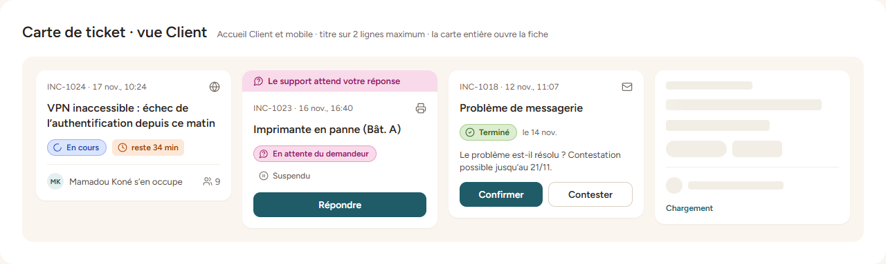

Rayon 14, marges 16, écart 12, `--shadow-xs`. Méta « INC-1024 · 17 nov., 10:24 » 12 Taupe + icône du service 16 ;
titre 16/22/600 sur **2 lignes max.** ; StatusBadge 24 + SlaBadge court ; pied sous un filet : Avatar 24 +
« Mamadou Koné s’en occupe » 13 + concernés. Variante en attente : bandeau haut fond
`--color-status-en-attente-bg`, texte `--color-status-en-attente-fg` 13/600, `message-circle-question` 15 ;
« Le support attend votre réponse » ; Primaire 36 « Répondre ». Variante terminée : « Terminé » + « le 14 nov. » ;
« Le problème est-il résolu ? Contestation possible jusqu’au JJ/MM. » ; Primaire « Confirmer » + Secondaire
« Contester » (36 px, moitié chacun). La carte entière ouvre la fiche.

## ProgressTracker

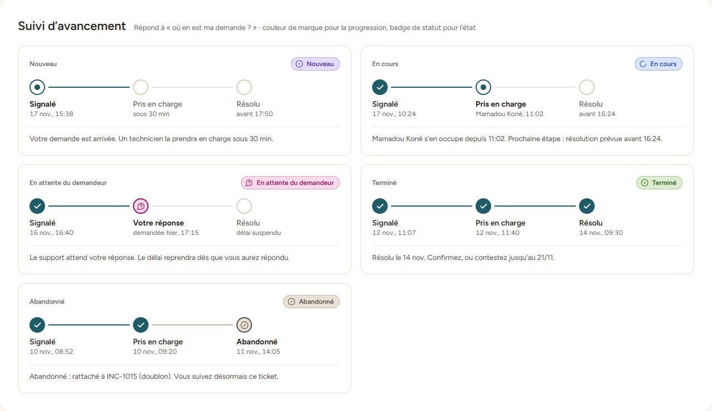

**4 jalons** (décision 9.11, VIGIE-7) : « Reçu → Vu par le support → Pris en charge → Terminé » ; la capture
montre les 3 étapes de la maquette, le style reste le même. Rond 28 (32 dans la fiche), bordure 2 : fait = plein
Pétrole + coche blanche ; en cours = contour Pétrole + point 10 px, libellé 700 ; à venir = bordure
`--color-neutral-300`, libellé 500 Taupe. En attente du demandeur : frise sur « Pris en charge » + mention
« En attente de votre réponse » aux couleurs du statut En attente. Abandonné : **pas de frise**, seulement le
message avec le motif. Trait 2 px Pétrole (Sable après le jalon courant).
Messages : « Votre demande est arrivée. Résolution prévue avant le 20/11 à 11 h. » · « Mamadou Koné s’en occupe depuis
11:02. Prochaine étape : résolution prévue avant 16:24. » · « Le support attend votre réponse. Le délai reprendra
dès que vous aurez répondu. » · « Résolu le 14 nov. Confirmez, ou contestez jusqu’au JJ/MM. » · « Abandonné :
rattaché à INC-1015 (doublon). Vous suivez désormais ce ticket. »

## TimelineItem

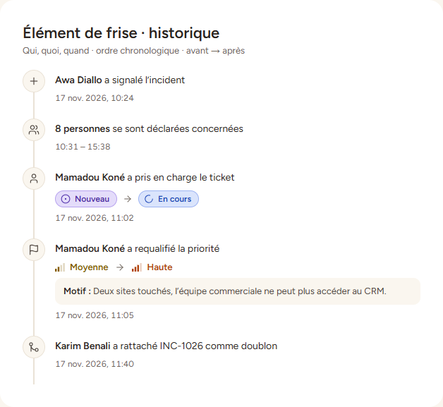

Voir [06](06-fiche-ticket-gestionnaire.md), Historique. Changement de statut : deux StatusBadge 24 reliés par
`arrow-right` 14 Taupe ; changement de priorité : deux priorités sans fond reliées de même.

## CommentBubble, TypingIndicator, PresenceAvatars

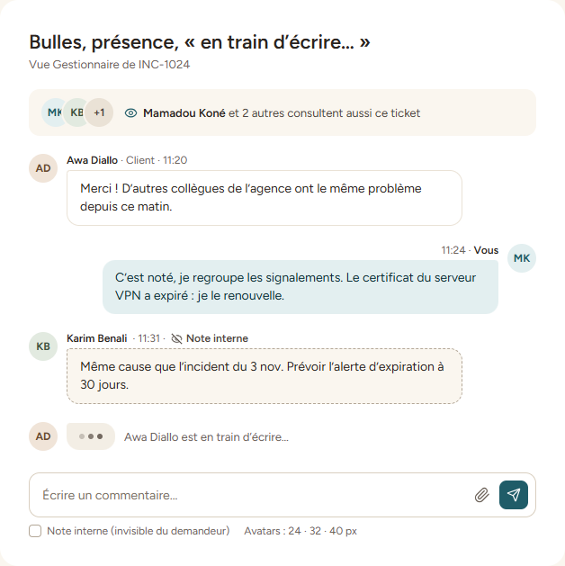

Voir [06](06-fiche-ticket-gestionnaire.md). Reçue : fond blanc, bordure Sable, rayon `4px 14px 14px 14px`.
Envoyée : fond `--color-brand-100`, texte `--color-brand-900`, rayon `14px 4px 14px 14px`, à droite.
Note interne : fond Lin, bordure `1px dashed --color-neutral-400`, étiquette `eye-off` « Note interne ».
Marges 10 × 14, 14/20, largeur max. 78–80 %. « en train d’écrire… » : 3 points de 6 px Taupe, opacité
0,25 → 1 en 1,2 s, décalés de 0,2 s.

## NotificationBell, NotificationPanel

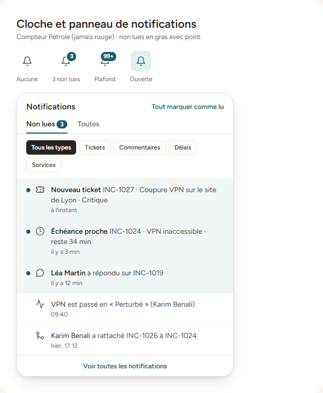

Voir [11](11-notifications.md).

## Toast

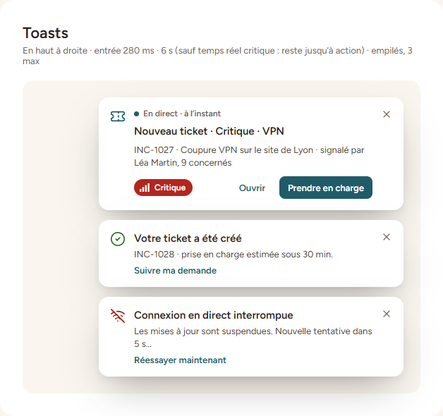

En haut à droite, largeur 400, rayon 14, marges 16, grille `22px minmax(0, 1fr) 16px`, écart 12, `--shadow-lg` ;
entrée 280 ms (glissé + fondu) ; durée 6 s, sauf temps réel critique (reste jusqu'à une action) ; empilés, 3 au
maximum ; `aria-live="polite"` (critique : `assertive`) ; fermeture `x` 16 Taupe.

- Temps réel : `ticket` 22 Pétrole ; « En direct · à l’instant » 12/600 Taupe avec point 7 px Pétrole ; titre
  15/20/600 ; texte 13/18 `--color-neutral-700` ; PriorityBadge Critique ; Tertiaire sm « Ouvrir » + Primaire sm
  « Prendre en charge ».
- Succès : `circle-check` 22 `--color-feedback-success-fg` · « Votre ticket a été créé » · « INC-1028 · … » · lien
  « Suivre ma demande » 13/600 Pétrole.
- Erreur de connexion : `wifi-off` 22 `--color-feedback-danger-fg` · « Connexion en direct interrompue » · « Les
  mises à jour sont suspendues. Nouvelle tentative dans 5 s… » · « Réessayer maintenant ».
- Réponse reçue (Client) : Avatar 32 · « **Mamadou Koné** a répondu sur INC-1024 » · citation 13 · « Voir la conversation ».

## Tabs, FilterBar, Pagination

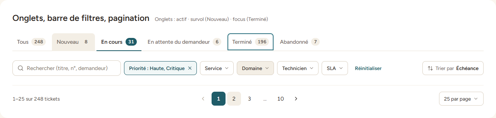

Voir [08](08-tous-les-tickets.md). Onglet survolé : fond `--color-neutral-100` ; focus `--shadow-focus-inset`.

## KpiCard

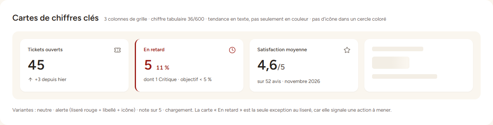

Rayon 14, marges 20, écart 10, `--shadow-xs` ; libellé 13/600 `--color-neutral-700` + icône 18 Taupe à droite
(**jamais dans un cercle**) ; chiffre `.text-numeric-xl` ; tendance **en texte** 13 (`arrow-up` 14 + « +3 depuis
hier »). Alerte : liseré gauche 3 px + libellé, icône et chiffre `--color-sla-retard-fg`, taux 15/600. Note sur 5 :
« 4,6 » + « /5 » 20 Taupe. Chargement : squelettes 55 % × 12, 40 % × 32 (reflet), 70 % × 12.

## Charts

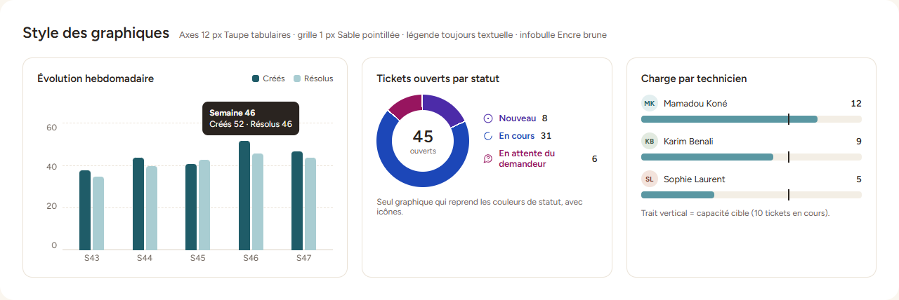

Voir [09](09-pilotage.md). Axes 12 Taupe tabulaires ; grille 1 px Sable pointillée ; légende toujours textuelle ;
infobulle fond `--color-neutral-900`, texte `--color-neutral-50`, rayon 8, marges 8 × 10, 12/16. Palette
`--color-chart-*` ; seul le graphique « par statut » utilise les couleurs de statut, avec icônes.

## Modal

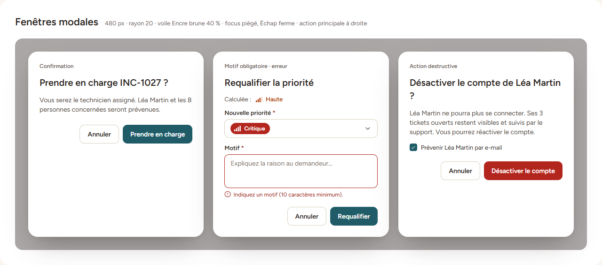

Largeur 480, rayon 20, marges 24, écart 14, `--shadow-lg`, voile `--color-overlay` ; **focus piégé, Échap
ferme**, retour du focus ; titre 20/28/600 ; texte 14/20 `--color-neutral-700` ; actions à droite (Secondaire
puis principale). Variantes : confirmation (« Prendre en charge INC-1027 ? ») ; motif obligatoire
(« Requalifier la priorité », motif ≥ 10 caractères) ; destructive (bouton Danger « Désactiver le compte »).

## EmptyState, ErrorState, Skeleton

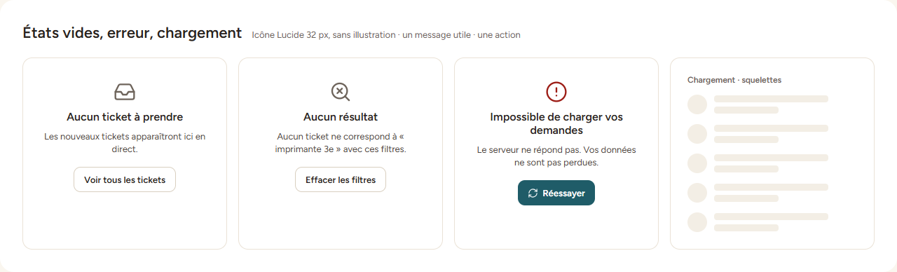

Carte bordée Sable (ou blanche dans un écran), rayon 14, marges 32 × 24 (40 × 24 dans un écran), centrée, écart
10 ; icône Lucide **32 px sans illustration** (Taupe ; `--color-feedback-danger-fg` pour une erreur) ; titre
16/600 ; texte 13–14/20 `--color-neutral-700` ; **une** action (Secondaire, ou Primaire « Réessayer » avec
`refresh-cw`). Squelettes : blocs `--color-neutral-100` rayon 4, reflet `linear-gradient(90deg, neutral-100 30%,
neutral-50 50%, neutral-100 70%)` sur 200 %, animation `vigie-reflet` 1,4 s linéaire. **Jamais de spinner isolé.**

## PageHeader

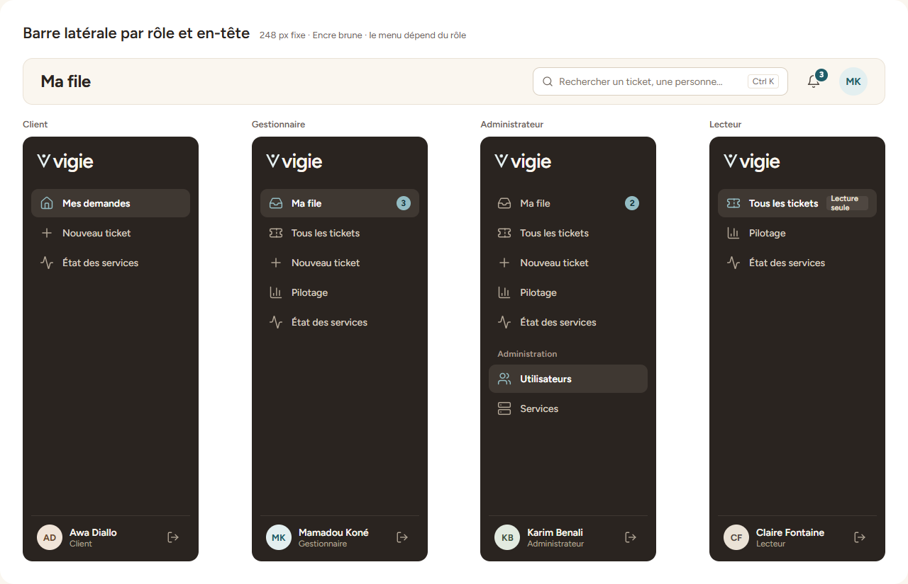

Voir le gabarit commun dans le [README](README.md).

## Identité (logo)

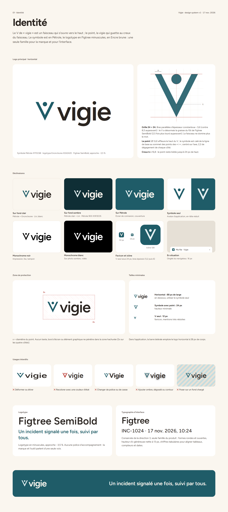

- Symbole : `polygon 0,0 3.6,0 12,16.8 20.4,0 24,0 12,24` + `circle 12, 2.8, r 2.8` (grille 24 × 24) ; logotype
  « vigie » Figtree 600 minuscules, approche -0.035em. Déjà codé dans `Sidebar` (28 px).
- Couleurs : sur fond clair, symbole Pétrole `--color-brand-600` + logotype Encre `--color-neutral-900` ; sur fond
  sombre ou Pétrole, symbole `--color-brand-100` + logotype `--color-neutral-50`.
- Tailles minimales : logo horizontal 88 px de large (en dessous, symbole seul) ; symbole avec point 24 px de
  haut ; V seul 12 px (favicon, bras épaissis à 5,2 puis 6).
- Zone de protection : 2 × le diamètre du point sur les quatre côtés.
- Interdits : déformer, recolorer avec une couleur d'état, changer de police ou de casse, ajouter ombre, dégradé
  ou contour, poser sur un fond chargé.
