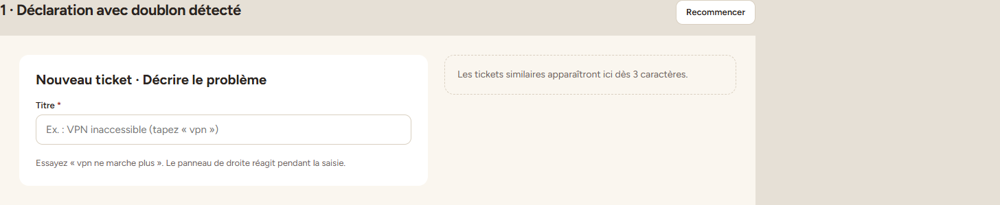
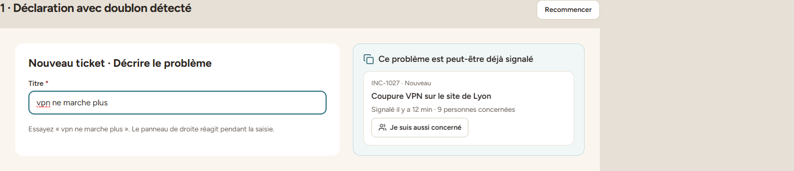
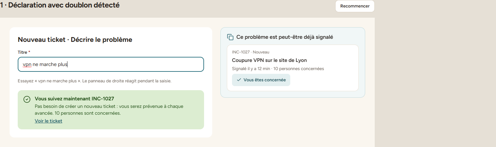
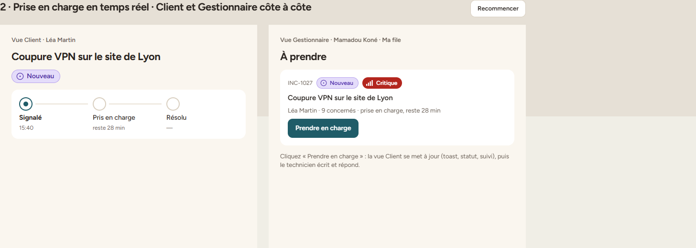
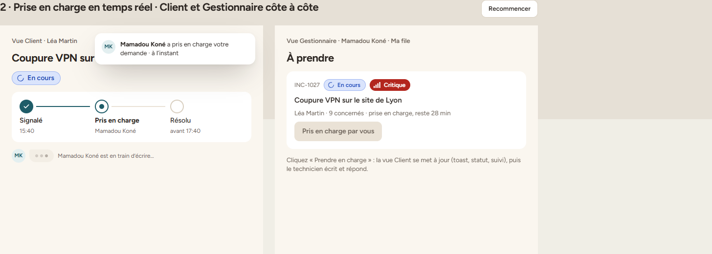
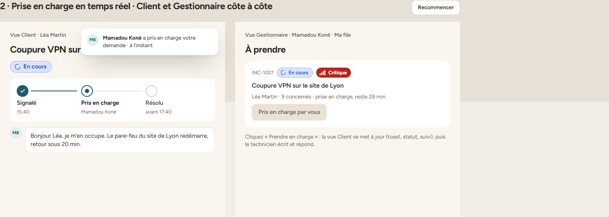
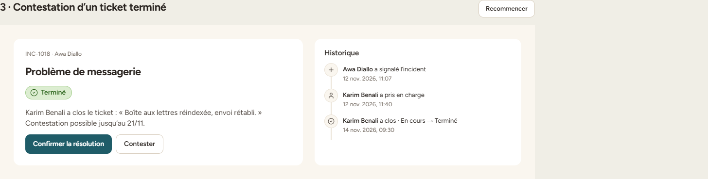
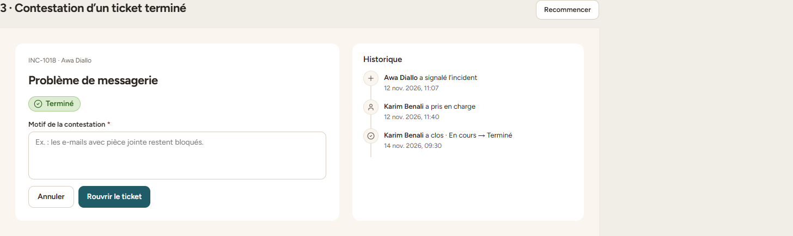
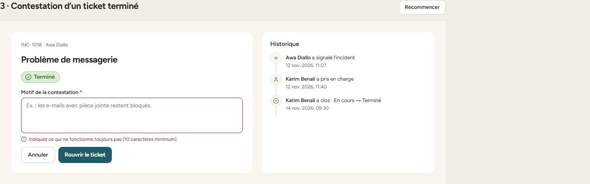
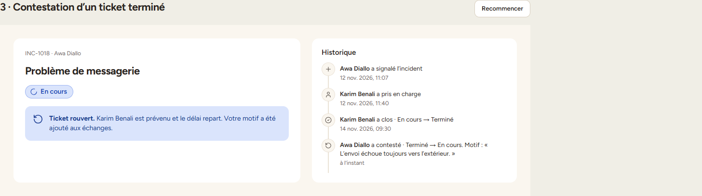

# Parcours interactifs

Trois enchaînements clés, capturés étape par étape. Ils montrent **ce qui change à l'écran** et dans quel
ordre ; les écrans complets sont dans leurs fiches.

## Parcours 1 — Déclaration avec doublon détecté

Écran : [03 — Créer un ticket](03-creer-un-ticket.md), étape 1.

| 1. Saisie vide                             | 2. Doublon proposé                             | 3. Rejoint                             |
| ------------------------------------------ | ---------------------------------------------- | -------------------------------------- |
|  |  |  |

1. Tant que le titre fait moins de 3 caractères, la colonne de droite affiche « Les tickets similaires
   apparaîtront ici dès 3 caractères. »
2. Dès 3 caractères (300 ms après la dernière frappe), le panneau « Ce problème est peut-être déjà signalé »
   propose 1 à 3 tickets ouverts (appel REST, pas Socket.io).
3. « Je suis aussi concerné » : le bouton devient « Vous êtes concerné » (`check`, fond `--color-brand-100`),
   le compteur de concernés augmente, et un encart de succès apparaît (fond `--color-status-termine-bg`, texte
   `--color-status-termine-strong`, rayon 12, marges 16, écart 12, entrée 280 ms) :
   « **Vous suivez maintenant INC-1027** Pas besoin de créer un nouveau ticket : chaque avancée vous sera
   notifiée. 10 personnes sont concernées. » + lien « Voir le ticket ».
   Le client devient **suiveur** (cadrage 3.1) ; il voit alors le ticket complet.

⚠ Le nombre de personnes concernées n'apparaît **qu'après** avoir rejoint : avant, la suggestion respecte le
plan A du cadrage 9.3 (titre, service, statut, date).

## Parcours 2 — Prise en charge en temps réel (Client et Gestionnaire côte à côte)

Écrans : [07 — Ma file](07-ma-file.md) et [05 — Fiche ticket Client](05-fiche-ticket-client.md).

| 1. Avant                                             | 2. Pris en charge, le technicien écrit              | 3. Message reçu                             |
| ---------------------------------------------------- | --------------------------------------------------- | ------------------------------------------- |
|  |  |  |

1. Côté Gestionnaire, la carte « À prendre » montre le ticket Nouveau, Critique, « Léa Martin · 9 concernés ·
   … » et le bouton « Prendre en charge ».
2. Clic sur « Prendre en charge » (appel REST, prise en charge atomique) : le bouton devient « Pris en charge
   par vous » (désactivé). **Côté Client, sans recharger** (`ticket:modifie`) : toast « **Mamadou Koné** a pris
   en charge votre demande · à l’instant », statut « En cours », jalon « Pris en charge » atteint avec le nom (4 jalons, voir [05](05-fiche-ticket-client.md)).
   Puis « Mamadou Koné est en train d’écrire… » (`ecriture:debut`).
3. Le message arrive (`commentaire:cree`) : « Bonjour Léa, je m’en occupe. Le pare-feu du site de Lyon redémarre,
   retour sous 20 min. »

## Parcours 3 — Contestation d'un ticket terminé

Écran : [05 — Fiche ticket Client](05-fiche-ticket-client.md), variante Terminé.

| 1. Terminé                             | 2. Formulaire                             | 3. Motif trop court                             | 4. Rouvert                             |
| -------------------------------------- | ----------------------------------------- | ----------------------------------------------- | -------------------------------------- |
|  |  |  |  |

1. « Karim Benali a clos le ticket : « Boîte aux lettres réindexée, envoi rétabli. » Contestation possible
   jusqu’au JJ/MM. » + « Confirmer la résolution » / « Contester ».
2. « Contester » ouvre « Motif de la contestation * » + « Annuler » / « Rouvrir le ticket ».
3. Moins de 10 caractères : « Indiquez ce qui ne fonctionne toujours pas (10 caractères minimum). »
4. Ticket rouvert : statut « En cours » ; encart fond `--color-status-en-cours-bg`, texte
   `--color-status-en-cours-strong`, `rotate-ccw` : « **Ticket rouvert.** Karim Benali est prévenu et le délai
   repart. Votre motif a été ajouté aux échanges. » ; l'historique ajoute « Awa Diallo a contesté · Terminé →
   En cours. Motif : « … » » (`rotate-ccw`).

⚠ Date limite = passage en Terminé **+ 15 jours** (cadrage 3.1), pas 7 jours comme dans la maquette.
